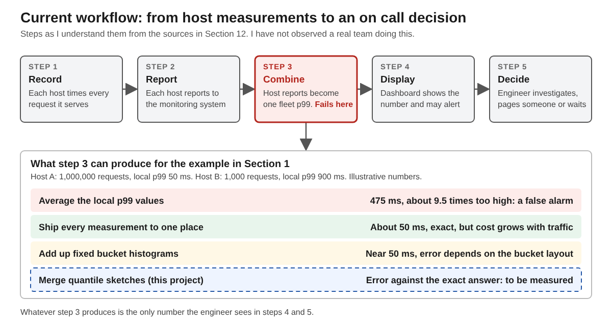

## Progress note

This initial draft defines the project's intended users and separates the driver-facing application from the processing system behind it. The application will combine potential enforcement locations predicted from highway images with crowdsourced reports supplied through WzSabre. I have identified a narrow six-week investigation: process a fixed image batch with two workers and recover from a worker failure without creating duplicate stored results. The source review clarified that WzSabre describes itself as a SABRE plugin, so I should not describe it as an official Waze API. User demand and the benefit of combining predictions with reports remain assumptions. No classmate feedback has been incorporated yet. Next, I will confirm the integration interface, collect feedback on the example scenario, and establish a single-worker baseline.

## 1 Problem research and scope

**Problem and affected people:** This project serves drivers who want to understand potential enforcement locations and recent reported activity along unfamiliar highways. The app combines locations predicted from highway images with crowdsourced alerts supplied through WzSabre. Predictions describe potential locations; reports describe observations that may no longer be current.

**Current workflow and difficulty — assumption:** Drivers check reporting apps for recent sightings and rely on familiarity for places without reports. Without local knowledge, they may have little information about potential locations. Manually reviewing roadway images takes time. Whether drivers find the combined information useful still needs user feedback.

| Stakeholder | Need |
|---|---|
| Highway driver | Distinguish potential enforcement locations from recent reports |
| Project developer | Process image batches and recover interrupted work without duplicate results |

**Concrete scenario:** Before taking an unfamiliar highway, a driver opens the map and sees a predicted location and a separate recent police report. Labels explain the difference. Meanwhile, a processing worker crashes while analyzing more images. The backend should recover that work without adding duplicate results to the map.

**Why distributed systems matter:** Expanding highway coverage requires processing many images while report updates and map requests continue. Background workers can share the image workload, and a queue can track work that needs to be retried. This semester will investigate whether that approach improves processing and recovery compared with one worker; distribution is not automatically necessary for a small prototype.

**Evidence:** My existing highway-image model provides the prediction component. [WzSabre](https://wzsabre.rocks/) describes a plugin for crowdsourced police and hazard reports; its exact integration interface still needs documentation. The [RabbitMQ work-queue tutorial](https://www.rabbitmq.com/tutorials/tutorial-two-python) demonstrates background task distribution and recovery of unacknowledged jobs. These sources support the proposed approach, but do not establish user demand or this project's performance.

**Six-week contribution:** Investigate a small pipeline using the existing model, a fixed image batch from one highway area, a queue, and two workers. Demonstrate recovery from one worker failure while maintaining one stored result per image and model version. A simple result view is sufficient; live alert integration is not required for this experiment.

**Semester II scope:** Develop the integrated driver-facing map with image predictions and WzSabre reports, clear labels and freshness information, and broader coverage of a limited highway region. Collect user feedback and evaluate prediction quality and backend performance.

**Exclusions:** Nationwide coverage, a full navigation system, new model-training research, and recovery from broker/database or whole-machine failure are outside this semester's scope. The app will not guarantee an officer's presence or absence.

*Figure 1. Proposed workflow connecting the driver's information needs to background image processing and a separate report-update path.*

## 12 Revision history and references

| Revision date | Change | Reason |
|---|---|---|
| November 6, 2026 | Initial problem statement and bounded scope | Assignment 1: explain the user need and this semester's contribution |

**Open question:** Do drivers find predicted locations useful alongside current reports, and can they distinguish the two? Next step: show the scenario and map sketch to classmates who drive and record their feedback.

**Assistance and reuse:** ChatGPT assisted with drafting, source checking, and the workflow figure. The project reuses my existing highway-image model and data.

### References

1. WzSabre. [Plugin homepage](https://wzsabre.rocks/). Undated; accessed November 6, 2026. Describes the crowdsourced police/hazard reporting source.
2. RabbitMQ. [Work Queues — Python tutorial](https://www.rabbitmq.com/tutorials/tutorial-two-python). Accessed November 6, 2026. Explains distributing jobs and redelivering unacknowledged work.
3. CSC 59866. [Design document template](https://bitbucket.org/ccny_kbrown6/csc59866_fall2026/src/main/design_document/DESIGN_DOCUMENT_TEMPLATE.md). Fall 2026. Source of this document's section structure.

**Supporting media:** [Workflow image](assets/workflow.png) and [editable figure](assets/workflow.svg).
