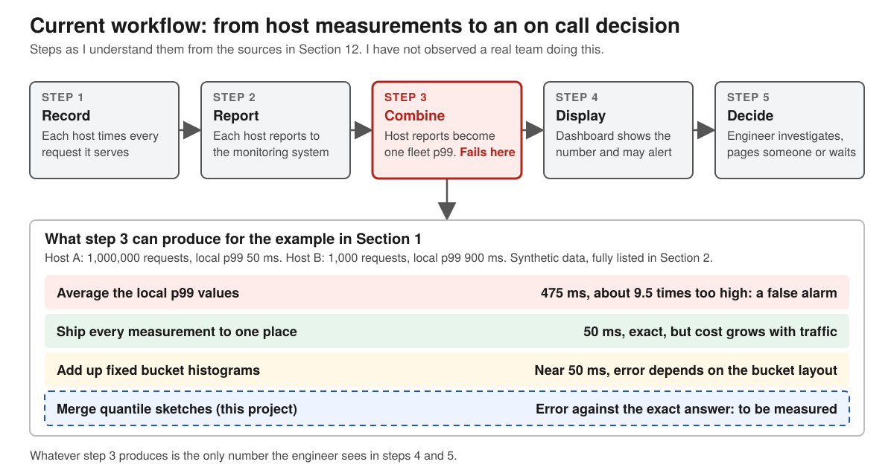

## Progress note

This revision keeps the driver-facing map as the longer-term goal and specifies the smaller distributed-processing experiment for this semester. I added testable requirements for submitting a fixed image batch, processing it, recovering from a worker crash, and storing one result per image and model version. I also compared a single-worker baseline with a queued two-worker approach. Performance and recovery thresholds are proposed, not measured. WzSabre integration and user demand remain unverified; no classmate feedback has been incorporated yet. Next, I will implement the baseline, verify the available integration interface, and collect feedback on the map scenario.

## 1 Problem research and scope

**Problem and affected people:** This project serves drivers who want to understand potential enforcement locations and recent reported activity along unfamiliar highways. The app combines locations predicted from highway images with crowdsourced alerts supplied through WzSabre. Predictions describe potential locations; reports describe observations that may no longer be current.

**Current workflow and difficulty — assumption:** Drivers check reporting apps for recent sightings and rely on familiarity for places without reports. Without local knowledge, they may have little information about potential locations. Manually reviewing roadway images takes time. Whether drivers find the combined information useful still needs user feedback.

| Stakeholder | Need |
|---|---|
| Highway driver | Distinguish potential enforcement locations from recent reports |
| Project developer | Process image batches and recover interrupted work without duplicate results |

**Concrete scenario:** Before taking an unfamiliar highway, a driver opens the map and sees a predicted location and a separate recent police report. Labels explain the difference. Meanwhile, a processing worker crashes while analyzing more images. The backend should recover that work without adding duplicate results to the map.

**Why distributed systems matter:** Expanding highway coverage requires processing many images while report updates and map requests continue. Background workers can share the image workload, and a queue can track work that needs to be retried. This semester will investigate whether that approach improves processing and recovery compared with one worker; distribution is not automatically necessary for a small prototype.

**Evidence:** My existing highway-image model provides the prediction component. [WzSabre](https://wzsabre.rocks/) describes a plugin for crowdsourced police and hazard reports; its exact integration interface still needs documentation. The [RabbitMQ work-queue tutorial](https://www.rabbitmq.com/tutorials/tutorial-two-python) demonstrates background task distribution and recovery of unacknowledged jobs. These sources support the proposed approach, but do not establish user demand or this project's performance.

**Six-week contribution:** Investigate a small pipeline using the existing model, a fixed image batch from one highway area, a queue, and two workers. Demonstrate recovery from one worker failure while maintaining one stored result per image and model version. A simple result view is sufficient; live alert integration is not required for this experiment.

**Semester II scope:** Develop the integrated driver-facing map with image predictions and WzSabre reports, clear labels and freshness information, and broader coverage of a limited highway region. Collect user feedback and evaluate prediction quality and backend performance.

**Exclusions:** Nationwide coverage, a full navigation system, new model-training research, and recovery from broker/database or whole-machine failure are outside this semester's scope. The app will not guarantee an officer's presence or absence.

*Figure 1. Proposed workflow connecting the driver's information needs to background image processing and a separate report-update path.*

## 2 System specification

**Scope of this specification:** These requirements apply to this semester's fixed-batch image-processing experiment, not the full driver-facing application planned for Semester II. The existing highway-image model supplies predictions; the experiment evaluates job processing and recovery rather than model accuracy.

### Functional requirements

| ID | Requirement | Concrete acceptance check |
|---|---|---|
| FR-1 | The system must accept a fixed batch of highway images and identify each image and model version. | Submit a test batch of 10 valid images; verify that all 10 appear in the processing record with their image identifiers and model version. |
| FR-2 | The system must run the existing prediction model on each valid image in the batch. | Process a batch and verify that every completed image has a prediction associated with its image identifier and model version. |
| FR-3 | The system must support processing the batch with two workers. | Start two workers, submit a batch with enough images for both, and verify from worker logs that both process at least one image. |
| FR-4 | The system must recover unfinished work when one processing worker stops unexpectedly. | Stop a worker while it is processing an image; keep the remaining worker running and verify that the interrupted image eventually reaches a completed state. |
| FR-5 | The system must make saved results and processing status available for inspection. | After processing, inspect the result view or records and identify completed, pending, or failed images and their saved predictions. |

### Correctness and quality requirements

| ID | Rule or target | Concrete acceptance check |
|---|---|---|
| CR-1 | For each image identifier and model version, the system must retain **at most one authoritative stored prediction**, even if processing is attempted more than once. | Force a retry of an image after an interrupted attempt; query stored results and verify that the image/model-version pair has no duplicate authoritative prediction. |
| QT-1 | **Proposed:** Complete at least 95% of a valid 20-image batch within 120 seconds using two workers, with no simulated failures. | Run the same 20-image batch with two workers, measure elapsed time, and count completed images; report actual results against the proposed target. |
| QT-2 | **Proposed:** After one worker crashes, complete its interrupted image within 60 seconds while the other worker remains available. | Kill one worker during processing, measure time until the interrupted image completes, and report the observed recovery time. |

These targets are preliminary and may need adjustment after measuring the single-worker baseline and the existing model's inference time. The targets are not current results or real-time guarantees.

### Assumptions and constraints

- **Assumptions:** The existing model can run inference on the selected images; the test images have stable identifiers; the two workers can access the same image inputs and saved results; a worker failure can be simulated by stopping one worker process.
- **Constraints:** Use a fixed image batch from one highway area and the existing model; limit the experiment to two workers and one simulated worker crash. A simple result view is sufficient. Live WzSabre integration, new model training, and recovery from broker, database, or whole-machine failures are outside this semester's experiment.
- **Unresolved:** The exact WzSabre integration interface and whether drivers find the combined map useful still require investigation and feedback.

### Example outcomes

**Ordinary case:** Input: a batch containing image `highway-001` under model version `v1`. The system processes the image and saves one record with image identifier `highway-001`, model version `v1`, status `completed`, and the model's predicted labels (for example, `shoulder: true`, `gore_area: false`). The labels here are illustrative, not a verified prediction.

**Unsuccessful attempt and recovery:** Input: the same kind of image job, but its worker crashes before the result is safely recorded. The attempt does not finish. The system makes the unfinished image available for another attempt; the surviving worker processes it, and the final stored results still contain at most one authoritative prediction for that image and model version. If recovery cannot complete, the job must remain visibly unfinished or failed rather than being shown as completed.

## 3 Comparison of possible approaches

The alternatives below are proposals to test, not a final architecture decision. Both use the existing model and a persistent result record so that the same requirements can be evaluated.

| Requirement or tradeoff | Approach A: Single-worker baseline | Approach B: Work queue with two workers |
|---|---|---|
| FR-1: Accept a fixed image batch | Read the batch directly in one process | Submit image jobs to a shared queue |
| FR-2: Run predictions | One process runs inference sequentially | Workers run inference on assigned images |
| FR-3: Use two workers | Does not meet this requirement | Designed to meet it; verify using worker logs |
| FR-4: Recover a worker crash | Needs restart and explicit tracking of unfinished images | Can reassign unfinished work after a worker crash, if acknowledgments and retries are configured correctly |
| FR-5: Inspect status and results | Store status and predictions in persistent records | Store status and predictions in shared persistent records |
| CR-1: One authoritative result per image and model version | Can enforce with a unique record key | Requires the same unique key and safe updates because retries or overlapping attempts may occur |
| QT-1: Proposed batch completion target | Measure as a baseline; may be slower | Measure with two workers; queue overhead may offset gains for small batches |
| QT-2: Proposed crash recovery target | Requires a restarted process or other recovery logic | Test whether the surviving worker finishes the interrupted job within the target |
| Complexity | Fewer moving parts; easier to debug | More coordination, queue setup, and failure cases |

**Approach A:** A single program loops through the fixed image batch, runs the model, and saves each result. It is the simplest way to establish inference time and validate output records. It does not by itself meet the two-worker requirement, and recovery would require additional bookkeeping or a restart procedure.

**Approach B:** A producer submits image-processing jobs to a queue such as RabbitMQ. Two workers consume jobs, run the existing model, and write results to a shared persistent store. Workers acknowledge jobs only after their outcomes are safely handled. A uniqueness rule on the image identifier and model version protects the stored result when a job is retried. RabbitMQ's work-queue tutorial supports the feasibility of distributing tasks and redelivering unacknowledged messages; it does **not** prove this project's recovery time or prevent duplicate database records by itself.

**Comparison status:** The single-worker approach is the baseline for measurement. The queued approach is a candidate for better throughput and worker-failure recovery, but its additional complexity must be justified by test evidence. The final choice will be made in Assignment 3.

### Four design steps to develop next

- **Architectural design:** At this step, I need to explain how batch submission, image-processing workers, the work queue if selected, and persistent results communicate.
- **Component design:** At this step, I need to explain which component validates jobs, runs model inference, tracks unfinished work, and saves predictions.
- **Data structure design:** At this step, I need to explain the image identifier, model version, job status, processing attempt, and stored prediction records.
- **Algorithm design:** At this step, I need to explain the sequence for processing an image, detecting an unfinished attempt, retrying it, and safely recording one authoritative result.

**Sources used in this comparison:** The existing highway-image model and data establish the available prediction workload, but not distributed-system performance. The [RabbitMQ work-queue tutorial](https://www.rabbitmq.com/tutorials/tutorial-two-python) explains worker distribution and unacknowledged-message recovery. The [WzSabre homepage](https://wzsabre.rocks/) supports the separate longer-term crowdsourced-report layer, not the implementation or performance of this semester's batch pipeline.

## 12 Revision history and references

| Revision date | Change | Reason |
|---|---|---|
| November 6, 2026 | Initial problem statement and bounded scope | Assignment 1: explain the user need and this semester's contribution |
| November 13, 2026 | Added testable requirements, proposed targets, examples, and comparison of two approaches | Assignment 2: specify required behavior and compare alternatives before selecting a design |

**Open questions:** Do drivers find predicted locations useful alongside current reports, and can they distinguish the two? What are the baseline processing and recovery times? Next steps: show the map scenario to classmates who drive, measure the single-worker baseline, and test whether the proposed targets are realistic.

**Assistance and reuse:** ChatGPT assisted with drafting, source checking, the workflow figure, and the Assignment 2 requirements and comparison tables. The project reuses my existing highway-image model and data.

### References

1. WzSabre. [Plugin homepage](https://wzsabre.rocks/). Undated; accessed November 6, 2026. Describes the crowdsourced police/hazard reporting source.
2. RabbitMQ. [Work Queues — Python tutorial](https://www.rabbitmq.com/tutorials/tutorial-two-python). Accessed November 6, 2026. Explains distributing jobs and redelivering unacknowledged work.
3. CSC 59866. [Design document template](https://bitbucket.org/ccny_kbrown6/csc59866_fall2026/src/main/design_document/DESIGN_DOCUMENT_TEMPLATE.md). Fall 2026. Source of this document's section structure.

**Supporting media:** [Workflow image](assets/workflow.png) and [editable figure](assets/workflow.svg).
