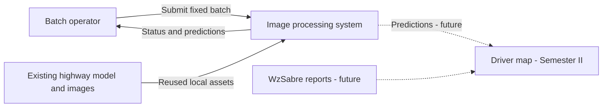
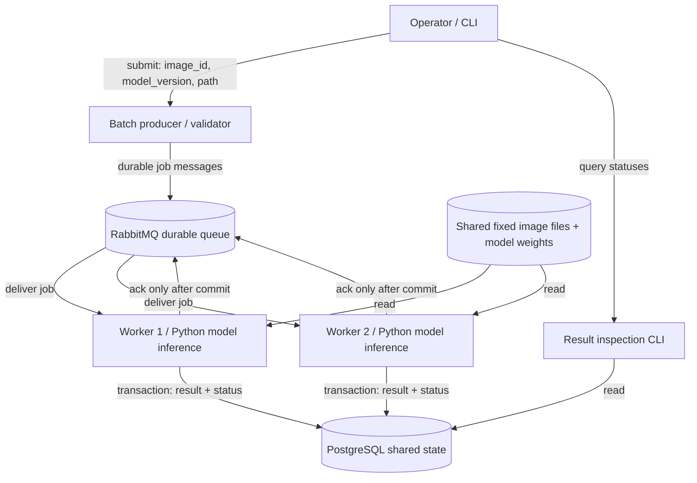

## Progress note

This revision selects the RabbitMQ two-worker pipeline for the semester experiment while retaining the single-worker implementation as a performance baseline. I added two decision records, a context view, a running-parts diagram, a component table, and an interface contract for processing one image. The design separates broker acknowledgments from database correctness: a retry may run inference again, but a unique image/model-version key prevents multiple authoritative results. A small SQLite experiment confirmed that a duplicate insert is rejected and a conflict-safe insert leaves one result. This does not establish PostgreSQL behavior under concurrency or RabbitMQ crash recovery, which remain to be tested. The map and WzSabre integration are still Semester II work. Prior peer or instructor feedback was not supplied, so I recorded the outstanding feedback requirement rather than inventing it. Next I will connect the existing model to a worker, run both configurations, and measure recovery.

## 1 Problem research and scope

**Problem and affected people:** This project serves drivers who want to understand potential enforcement locations and recent reported activity along unfamiliar highways. The app combines locations predicted from highway images with crowdsourced alerts supplied through WzSabre. Predictions describe potential locations; reports describe observations that may no longer be current.

**Current workflow and difficulty — assumption:** Drivers check reporting apps for recent sightings and rely on familiarity for places without reports. Without local knowledge, they may have little information about potential locations. Manually reviewing roadway images takes time. Whether drivers find the combined information useful still needs user feedback.

| Stakeholder | Need |
|---|---|
| Highway driver | Distinguish potential enforcement locations from recent reports |
| Project developer | Process image batches and recover interrupted work without duplicate results |

**Concrete scenario:** Before taking an unfamiliar highway, a driver opens the map and sees a predicted location and a separate recent police report. Labels explain the difference. Meanwhile, a processing worker crashes while analyzing more images. The backend should recover that work without adding duplicate results to the map.

**Why distributed systems matter:** Expanding highway coverage requires processing many images while report updates and map requests continue. Background workers can share the image workload, and a queue can track work that needs to be retried. This semester will investigate whether that approach improves processing and recovery compared with one worker; distribution is not automatically necessary for a small prototype.

**Evidence:** My existing highway-image model provides the prediction component. [WzSabre](https://wzsabre.rocks/) describes a plugin for crowdsourced police and hazard reports; its exact integration interface still needs documentation. The [RabbitMQ work-queue tutorial](https://www.rabbitmq.com/tutorials/tutorial-two-python) demonstrates background task distribution and recovery of unacknowledged jobs. These sources support the proposed approach, but do not establish user demand or this project's performance.

**Six-week contribution:** Investigate a small pipeline using the existing model, a fixed image batch from one highway area, a queue, and two workers. Demonstrate recovery from one worker failure while maintaining one stored result per image and model version. A simple result view is sufficient; live alert integration is not required for this experiment.

**Semester II scope:** Develop the integrated driver-facing map with image predictions and WzSabre reports, clear labels and freshness information, and broader coverage of a limited highway region. Collect user feedback and evaluate prediction quality and backend performance.

**Exclusions:** Nationwide coverage, a full navigation system, new model-training research, and recovery from broker/database or whole-machine failure are outside this semester's scope. The app will not guarantee an officer's presence or absence.

*See the context and running-parts diagrams in [Section 4](#4-initial-architecture). The original workflow image is optional supporting media and is not included in this Markdown download.*


## 2 System specification

**Scope of this specification:** These requirements apply to this semester's fixed-batch image-processing experiment, not the full driver-facing application planned for Semester II. The existing highway-image model supplies predictions; the experiment evaluates job processing and recovery rather than model accuracy.

### Functional requirements

| ID | Requirement | Concrete acceptance check |
|---|---|---|
| FR-1 | The system must accept a fixed batch of highway images and identify each image and model version. | Submit a test batch of 10 valid images; verify that all 10 appear in the processing record with their image identifiers and model version. |
| FR-2 | The system must run the existing prediction model on each valid image in the batch. | Process a batch and verify that every completed image has a prediction associated with its image identifier and model version. |
| FR-3 | The system must support processing the batch with two workers. | Start two workers, submit a batch with enough images for both, and verify from worker logs that both process at least one image. |
| FR-4 | The system must recover unfinished work when one processing worker stops unexpectedly. | Stop a worker while it is processing an image; keep the remaining worker running and verify that the interrupted image eventually reaches a completed state. |
| FR-5 | The system must make saved results and processing status available for inspection. | After processing, inspect the result view or records and identify completed, pending, or failed images and their saved predictions. |

### Correctness and quality requirements

| ID | Rule or target | Concrete acceptance check |
|---|---|---|
| CR-1 | For each image identifier and model version, the system must retain **at most one authoritative stored prediction**, even if processing is attempted more than once. | Force a retry of an image after an interrupted attempt; query stored results and verify that the image/model-version pair has no duplicate authoritative prediction. |
| QT-1 | **Proposed:** Complete at least 95% of a valid 20-image batch within 120 seconds using two workers, with no simulated failures. | Run the same 20-image batch with two workers, measure elapsed time, and count completed images; report actual results against the proposed target. |
| QT-2 | **Proposed:** After one worker crashes, complete its interrupted image within 60 seconds while the other worker remains available. | Kill one worker during processing, measure time until the interrupted image completes, and report the observed recovery time. |

These targets are preliminary and may need adjustment after measuring the single-worker baseline and the existing model's inference time. The targets are not current results or real-time guarantees.

### Assumptions and constraints

- **Assumptions:** The existing model can run inference on the selected images; the test images have stable identifiers; the two workers can access the same image inputs and saved results; a worker failure can be simulated by stopping one worker process.
- **Constraints:** Use a fixed image batch from one highway area and the existing model; limit the experiment to two workers and one simulated worker crash. A simple result view is sufficient. Live WzSabre integration, new model training, and recovery from broker, database, or whole-machine failures are outside this semester's experiment.
- **Unresolved:** The exact WzSabre integration interface and whether drivers find the combined map useful still require investigation and feedback.

### Example outcomes

**Ordinary case:** Input: a batch containing image `highway-001` under model version `v1`. The system processes the image and saves one record with image identifier `highway-001`, model version `v1`, status `completed`, and the model's predicted labels (for example, `shoulder: true`, `gore_area: false`). The labels here are illustrative, not a verified prediction.

**Unsuccessful attempt and recovery:** Input: the same kind of image job, but its worker crashes before the result is safely recorded. The attempt does not finish. The system makes the unfinished image available for another attempt; the surviving worker processes it, and the final stored results still contain at most one authoritative prediction for that image and model version. If recovery cannot complete, the job must remain visibly unfinished or failed rather than being shown as completed.

## 3 Selected solution and decision records

**Selected solution: Approach B, a RabbitMQ work queue with two model workers and one shared persistent result store.** Approach A, a sequential single-worker pipeline, remains the baseline. Both reuse the existing highway-image model and fixed image batch. Approach B directly addresses [FR-3](#functional-requirements) and creates a testable recovery mechanism for [FR-4](#functional-requirements); it adds broker and concurrency complexity. The selection is provisional until measured against [QT-1 and QT-2](#correctness-and-quality-requirements).

| Criterion | A: sequential baseline | B: queue + two workers (selected) |
|---|---|---|
| Inference | One process handles images in order | Two processes consume jobs independently |
| Worker crash | Restart/resume logic must be added | Unacknowledged delivery can be reassigned |
| Duplicate protection | Unique database key | Same unique key is essential for retries |
| Operational cost | Smallest setup | Broker, workers, database, monitoring |
| Evidence needed | Baseline elapsed time | Throughput and actual kill-worker recovery |

### Decision record DR-1 — Processing topology (November 22, 2026)

- **Context:** A fixed batch must be processed by two workers and unfinished jobs must survive one worker-process crash (FR-2–FR-4).
- **Options:** A single sequential worker; or RabbitMQ with two independent consumers.
- **Choice:** RabbitMQ and two consumers, compared with a sequential baseline.
- **Reasons:** Explicit work distribution, manual acknowledgments, and redelivery of unacknowledged jobs support the required experiment. Two workers also allow one to continue after the other exits.
- **Consequences:** Need broker setup, durable queue/messages, idempotent storage, worker logs, and failure tests. Queueing does not guarantee faster processing or a 60-second recovery.
- **Reconsider if:** Two-worker throughput is consistently worse for the batch, worker recovery fails the proposed threshold, or deployment complexity outweighs the benefit. Retain the baseline even if B is rejected.

### Decision record DR-2 — Authoritative result storage (November 22, 2026)

- **Context:** RabbitMQ may redeliver a job after a worker crashes, including after the database commit but before acknowledgment (CR-1).
- **Options:** Rely on queue acknowledgments alone; or enforce a unique `(image_id, model_version)` database key and use conflict-safe writes.
- **Choice:** Shared PostgreSQL result table with a composite unique key; commit before acknowledging the message.
- **Reasons:** The database, not the queue, must decide whether an authoritative prediction already exists. A retry should not create a second authoritative row.
- **Consequences:** Inference may execute more than once; this is **at-least-once processing with idempotent authoritative storage**, not exactly-once execution. Status and failed-attempt tracking need separate handling.
- **Reconsider if:** Model versions cannot be uniquely identified, results need intentional revisions, or concurrency tests reveal incorrect status transitions. In that case, introduce a revision/attempt schema while preserving one authoritative result per key.

## 4 Initial architecture

### Context view

The **batch operator** submits a fixed set of local highway image references and inspects status/results. The system runs the existing ML classifier and persists predictions. **WzSabre** and the eventual driver-facing map are external/future integrations, not dependencies of this semester's experiment.



### Running-parts / container view



**Responsibilities and deployment:** The producer validates identifiers and accessible file paths, creates pending records, and publishes jobs. RabbitMQ stores/delivers pending messages; each worker loads the **reused** existing model, reads the image, performs inference, and writes to PostgreSQL. The database stores image ID, model version, processing status, prediction, timestamps, and attempt/error metadata (final schema still under design). The inspection CLI reads saved state. For the initial experiment, the producer, RabbitMQ, PostgreSQL, and two Python worker **processes run on one development computer** (separate processes/containers as needed); this tests worker-process failure, not machine-level availability. Both workers must access the same local image files and weights. The producer, worker adapter, schema, and CLI are **built**; RabbitMQ, PostgreSQL, and trained model are **reused**. A synthetic delay or forced worker termination may be **simulated** for a reproducible crash test, but any simulation must be labeled and real model inference must be tested separately.

**Communication and recovery:** Publish persistent messages to a durable queue; workers use manual acknowledgment and prefetch of one. A worker writes and commits a result before `basic_ack`. If a process dies before acknowledgment, RabbitMQ can redeliver its unacknowledged message to the surviving consumer. On retry, the database unique key prevents another authoritative row. If the DB is unavailable, do not acknowledge; record/observe the failure and retry according to a bounded policy still to be finalized. RabbitMQ alone does not track application-level completion status.

## 5 Components and critical interface

| Component | Responsibility | Input / output | Saved state / location |
|---|---|---|---|
| Batch producer | Validate fixed batch; register jobs; publish messages | Image IDs, version, paths → accepted/rejected | Pending jobs in PostgreSQL; local CLI |
| RabbitMQ broker | Hold and deliver jobs; redeliver unacknowledged jobs | Durable job messages → worker deliveries | Queue messages; local service/container |
| Worker 1 / Worker 2 | Read image, run model, commit result, acknowledge | Job → prediction or failure | Reads shared files; writes PostgreSQL; local Python processes |
| Existing model adapter | Load weights, normalize image, produce labels | Image → shoulder/gore-area/viable predictions | Reused weights, in worker memory |
| PostgreSQL store | Enforce uniqueness, retain result/status | Insert/upsert/query → records | Persistent tables; local service/container |
| Inspection CLI | Show pending/completed/failed work | Batch ID → statuses/results | Read-only database access; local process |

### Critical operation: `process_image_job` — FR-2, FR-4, CR-1

**Input (queue message, proposed JSON):**

```json
{"batch_id":"batch-001","image_id":"highway-001","model_version":"v1","image_path":"images/highway-001.jpg"}
```

**Preconditions:** Valid identifiers; model `v1` available; path points to a readable image in shared storage. The producer has registered the job. Message delivery can occur more than once.

**Processing contract:** (1) Consumer receives message without auto-ack. (2) Check whether an authoritative result already exists for `(image_id, model_version)`; if yes, acknowledge without replacing it. (3) Otherwise read the image and run the existing model. (4) Within a database transaction, insert one authoritative prediction with the composite unique key and mark completion; if a concurrent insert already won, preserve the existing result. (5) Commit, then acknowledge. The database is the authority for completion, not a worker's memory.

**Successful output (persisted record, illustrative prediction only):**

```json
{"image_id":"highway-001","model_version":"v1","status":"completed","prediction":{"shoulder":true,"gore_area":false,"viable":true}}
```

**Return / observation:** The consumer acknowledges the message; the inspection CLI reports `completed` and the stored prediction. A duplicate delivery returns the already stored result and does not add another authoritative record.

**Unsuccessful example:** Worker 1 receives `highway-001`, then is killed before commit/ack. Its delivery remains unacknowledged and is eligible for redelivery; Worker 2 may run inference and commit. If it succeeds, exactly one authoritative row exists. If the file is missing, the operation does **not** mark completion; it records a failure when possible and routes the message according to a bounded retry/dead-letter policy (not implemented yet).

| Error / condition | Expected handling | Open detail |
|---|---|---|
| Malformed job / missing image | Reject during submission when possible; otherwise mark failed | Exact validation errors and dead-letter behavior TBD |
| Model inference exception | Do not save a completed prediction; log failure | Retry count/backoff TBD |
| Database unavailable | Do not acknowledge before commit; retry later | Avoid infinite rapid redelivery; policy TBD |
| Crash after commit, before ack | Redelivery sees existing key and acknowledges | Verify with integration test |
| Duplicate simultaneous attempts | Unique key allows only one authoritative row | PostgreSQL concurrency test pending |

**Data model under refinement:** `jobs(batch_id, image_id, model_version, image_path, status, attempt_count, last_error, updated_at)` and `results(image_id, model_version, prediction_json, completed_at, UNIQUE(image_id, model_version))`. Exact DDL, allowed status transitions, and transaction boundaries will be finalized after the PostgreSQL test. The uniqueness scope intentionally spans batches; changing that decision would require updating CR-1.

## 9 Smallest implementation path and feasibility experiment

**Smallest useful vertical slice:** First, run one image through the existing model and save one result. Next, add a 10-image batch producer and status inspection. Then connect one RabbitMQ consumer, enable manual acknowledgments, and add a second identical worker. Finally, kill one worker mid-job and measure whether the other finishes, comparing a 20-image batch against the single-worker baseline. Do not build the driver map or live WzSabre integration for this slice.

### Feasibility experiment FE-1 — Duplicate result constraint (conducted November 22, 2026)

- **Question:** Can a database-enforced composite key prevent a retry from creating a second authoritative prediction for the same image and model version (CR-1)?
- **Procedure:** Use an in-memory SQLite database as a **database-constraint simulation**, create `results(image_id, model_version, prediction)` with `PRIMARY KEY(image_id, model_version)`, insert one prediction for `highway-001`/`v1`, attempt a conflicting second insert, then try `ON CONFLICT ... DO NOTHING` and count rows for that key. This experiment uses illustrative predictions, not the trained model.
- **Actual evidence:** The second plain insert raised `IntegrityError: UNIQUE constraint failed: results.image_id, results.model_version`. The conflict-safe insertion completed without adding a row. The final count for `(highway-001, v1)` was **1**.
- **Finding:** A composite uniqueness constraint blocks duplicate authoritative rows in this sequential SQLite test. It does **not** prove the PostgreSQL implementation, concurrent writes, message redelivery, or recovery time.
- **Resulting decision:** Keep DR-2's composite key and conflict-safe insert. Repeat the test in PostgreSQL with two concurrent writers before claiming CR-1 is fully verified.

**Reproducible experiment snippet:**

```python
import sqlite3
c = sqlite3.connect(':memory:')
c.execute('CREATE TABLE results(image_id TEXT, model_version TEXT, prediction TEXT, PRIMARY KEY(image_id, model_version))')
c.execute("INSERT INTO results VALUES ('highway-001','v1','true')")
try:
    c.execute("INSERT INTO results VALUES ('highway-001','v1','false')")
except sqlite3.IntegrityError as error:
    print(type(error).__name__, error)
c.execute("INSERT INTO results VALUES ('highway-001','v1','false') ON CONFLICT(image_id, model_version) DO NOTHING")
print(c.execute("SELECT COUNT(*) FROM results WHERE image_id='highway-001' AND model_version='v1'").fetchone()[0])  # 1
```

**Pending FE-2 (not yet performed):** Run RabbitMQ + two real worker processes; log job IDs, worker IDs, delivery/retry count, timestamps, and database row count. Kill a worker during inference, verify redelivery and completion, and measure elapsed recovery against QT-2. Repeat a 20-image no-failure batch with one and two workers for QT-1. **No measured throughput or crash-recovery outcome is claimed yet.**

## 12 Revision history, feedback response, and references

| Revision date | Change | Reason / affected sections |
|---|---|---|
| November 6, 2026 | Initial problem and scope | Assignment 1; Section 1 |
| November 13, 2026 | Testable requirements and baseline comparison | Assignment 2; Sections 2–3 |
| November 22, 2026 | Selected queue architecture, added two decision records, diagrams, components, interface, and feasibility evidence | Assignment 3; Sections 3–5 and 9 |

### Feedback and response record

**Prior peer/instructor feedback:** The supplied Assignment 2 document explicitly says no classmate feedback had been incorporated. No actual instructor or peer comments were supplied for this update. **Two required prior feedback items remain unverified; they must be entered here from the real review before submission.** The following are design revisions based on the Assignment 3 rubric, **not** fabricated feedback:

| Source | Issue | Response | Affected sections | Status |
|---|---|---|---|---|
| Assignment 3 requirements (not peer feedback) | Comparison had no selected solution | Selected B and retained A as baseline; documented reversal criteria | 3, 4, 9 | Addressed |
| Assignment 3 requirements (not peer feedback) | No interface or measured feasibility evidence | Added `process_image_job` contract and SQLite uniqueness experiment | 5, 9 | Partially addressed; integration test pending |
| Prior feedback item 1 | **Insert actual comment, reviewer, and date** | **Insert substantive response and linked revision** | TBD | Awaiting actual feedback |
| Prior feedback item 2 | **Insert actual comment, reviewer, and date** | **Insert substantive response and linked revision** | TBD | Awaiting actual feedback |

**Consistency / unresolved items:** FR-3/FR-4 and CR-1 now map to Sections 3–5 and 9. PostgreSQL concurrency, RabbitMQ worker redelivery, actual performance thresholds, status transitions, and retry/dead-letter policy still need evidence. Driver feedback and the WzSabre interface remain future work. The older workflow image links below require the actual `assets/` files in the repository; the Mermaid diagrams above render directly in compatible Markdown viewers. If Bitbucket does not render Mermaid, export the diagrams as SVG/PNG and embed them.

**Assistance and reuse:** ChatGPT helped revise the design, create the Mermaid diagrams, and execute the SQLite constraint experiment. The project reuses the author's existing highway-image model and dataset. This file is an edited deliverable, **not evidence of a Git commit**.

### References

1. WzSabre. [Plugin homepage](https://wzsabre.rocks/). Describes the proposed future crowdsourced report source; integration not verified.
2. RabbitMQ. [Work Queues — Python tutorial](https://www.rabbitmq.com/tutorials/tutorial-two-python). Manual acknowledgments and worker distribution.
3. RabbitMQ. [Publisher confirms and consumer acknowledgements](https://www.rabbitmq.com/docs/confirms). Delivery and acknowledgment behavior.
4. PostgreSQL. [Unique constraints](https://www.postgresql.org/docs/current/ddl-constraints.html#DDL-CONSTRAINTS-UNIQUE-CONSTRAINTS). Planned database correctness mechanism.
5. SQLite. [UPSERT](https://www.sqlite.org/lang_upsert.html). FE-1 conflict-safe insert behavior.
6. CSC 59866. [Design document template](https://bitbucket.org/ccny_kbrown6/csc59866_fall2026/src/main/design_document/DESIGN_DOCUMENT_TEMPLATE.md). Course document structure.

**Prior supporting media (must be committed separately if used):** [workflow PNG](assets/workflow.png) and [workflow SVG](assets/workflow.svg). The inline Mermaid diagrams are self-contained in this document.
