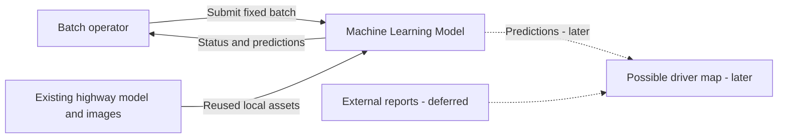
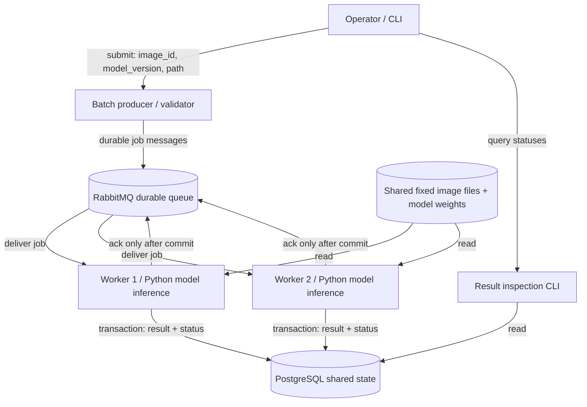

## Progress note

This revision makes the image-pipeline developer the primary user of the first prototype, rather than treating the driver map as an immediate deliverable. I narrowed the scope to reliable inference on a fixed highway-image batch, with an inspectable result viewer; external reports are deferred. In response to instructor feedback, I specified a saved-result/lost-acknowledgment retry, invalid-image outcomes, stable image/model keys, and a fair single-versus-two-worker comparison. I retained RabbitMQ with two workers as a provisional architecture, subject to measured completion and recovery benefits. The SQLite uniqueness experiment supports the database constraint only; it does not establish broker redelivery or PostgreSQL concurrency. Remaining risks include the actual crash-recovery behavior, timing on the chosen machine, and defining bounded retries. Next I will connect the model to the worker, record the exact workload and environment, and run baseline and failure tests.

## 1 Problem research and scope

**Primary user and immediate need:** The first prototype serves **the developer operating the existing highway-image classifier**. The developer needs to run inference on a batch, know which images completed or failed, and recover from a stopped worker without missing images or storing duplicate authoritative predictions. Without durable job tracking, a failed process can leave uncertain progress and require manual checking or rerunning. **Impact is a design hypothesis**, not a measured user study; the upcoming baseline and crash test will quantify it.

**Secondary, later user:** A driver might eventually view predicted roadway features and separately labeled crowdsourced reports. That map is a potential use of the pipeline's output, not the first prototype's user workflow. Driver demand has not been established; personal opinions about speed limits are not evidence of demand.

| Stakeholder | Immediate need | Evidence status |
|---|---|---|
| Pipeline developer (primary) | Complete and inspect fixed inference batches; recover interrupted jobs; avoid duplicate authoritative results | Existing classifier and dataset establish a real workload; failure frequency/cost not yet measured |
| Driver (future) | Understand potential locations versus time-sensitive reports | User need and report integration unverified |

**Concrete first-prototype scenario:** The developer submits 20 readable images from one highway region using model `M1`. Image `IMG-017` is processed and its result committed, but its worker stops before acknowledging the queue message. Another worker receives the message and finds the saved result. The developer sees **one** authoritative `IMG-017/M1` prediction and an attempt history showing a retry. An unreadable `IMG-018` is marked `failed` with a reason rather than incorrectly shown as completed.

**Why investigate distributed processing:** Multiple workers might reduce batch completion time and let one worker continue after another fails, but queue overhead and model memory use could erase the benefit. The design must compare outcomes against a single-worker baseline rather than treat “uses two workers” as proof of improvement. The work distributed here is **image inference**, not model training.

**Evidence and limitations:** The existing highway-image model and labeled images supply the inference workload. RabbitMQ documents manual acknowledgments and redelivery of unacknowledged messages; this does not establish this project's performance. The precise image source/API used to collect the original dataset must be verified against project records before asserting provenance. WzSabre is a possible later report source; its integration interface and freshness rules are unverified.

**This semester's bounded contribution:** Implement and assess a local batch-inference pipeline for one fixed region: producer, one- and two-worker configurations, durable queue, persistent result/status storage, inspection CLI, and one worker-process crash test. Compare the same workload under both configurations.

**Semester II initial scope:** Deliver a usable **result viewer for one highway region**, showing image identifiers, predictions, statuses, and errors. Consider a driver map or external reports only after validating the viewer and documenting source interfaces, freshness, and user need; those are not committed Semester II deliverables.

**Out of scope for this prototype:** Nationwide coverage, live WzSabre integration, full navigation, new model training, and recovery from broker/database/whole-machine failure. Predictions do not establish actual officer presence.

**Navigation:** [Requirements](#2-system-specification) · [Decisions](#3-selected-solution-and-decision-records) · [Architecture](#4-initial-architecture) · [Operation](#5-components-and-critical-interface) · [Experiment](#9-smallest-implementation-path-and-feasibility-experiment) · [Feedback](#12-revision-history-feedback-response-and-references)

## 2 System specification

**Scope of this specification:** These requirements apply to this semester's fixed-batch image-processing experiment, not the full driver-facing application planned for Semester II. The existing highway-image model supplies predictions; the experiment evaluates job processing and recovery rather than model accuracy.

### Functional requirements

| ID | Requirement | Concrete acceptance check |
|---|---|---|
| FR-1 | The system must accept a fixed batch of highway images and identify each image and model version. | Submit a test batch of 10 valid images; verify that all 10 appear in the processing record with their image identifiers and model version. |
| FR-2 | The system must run the existing prediction model on each valid image in the batch. | Process a batch and verify that every completed image has a prediction associated with its image identifier and model version. |
| FR-3 | The system must support a configurable one-worker baseline and two-worker candidate. | Run the identical batch and model in both modes; record completion time, successful/failed/missing counts, and per-worker assignments. |
| FR-4 | The queued configuration must recover a job when a worker stops before acknowledgment, including after a successful database commit. | Commit IMG-017/M1, stop its worker before acknowledgment, and verify redelivery, a logged retry, one final authoritative result, and completion by the surviving worker. |
| FR-5 | The system must make saved results and processing status available for inspection. | After processing, inspect the result view or records and identify completed, pending, or failed images and their saved predictions. |

### Correctness and quality requirements

| ID | Rule or target | Concrete acceptance check |
|---|---|---|
| CR-1 | For each image identifier and model version, the system must retain **at most one authoritative stored prediction**, even if processing is attempted more than once. | Save IMG-017/M1, simulate loss of its acknowledgment, redeliver it, and verify exactly one authoritative result plus a visible second attempt. |
| QT-1 | **Proposed:** Complete at least 19 of the same 20 valid images within 120 seconds using two workers, without failures; compare elapsed time and completeness against one worker. | Record image IDs, source/format, resolution, model checkpoint/version, preprocessing, CPU/GPU, RAM, runtime, and whether weights are loaded once per worker; run the identical 20 valid images with one and two workers and compare time, completion rate, and errors. |
| QT-2 | **Proposed:** After one worker crashes, complete its interrupted image within 60 seconds while the other worker remains available. | Kill one worker during processing, measure time until the interrupted image completes, and report the observed recovery time. |

These targets are preliminary and may need adjustment after measuring the single-worker baseline and the existing model's inference time. The targets are not current results or real-time guarantees.

### Assumptions and constraints

- **Assumptions:** The existing model can run inference on the selected images; the test images have stable identifiers; the two workers can access the same image inputs and saved results; a worker failure can be simulated by stopping one worker process.
- **Constraints:** Use a fixed image batch from one highway area and the existing model; limit the experiment to two workers and one simulated worker crash. A simple result view is sufficient. Live WzSabre integration, new model training, and recovery from broker, database, or whole-machine failures are outside this semester's experiment.
- **Unresolved:** Exact workload file list/checksums, model checkpoint identifier, preprocessing settings, machine specifications, retry/dead-letter policy, and real timing results must be recorded before the full benchmark. Future map demand and report interfaces remain separate questions.

### Example outcomes

**Success:** `IMG-001/M1` is readable, inference succeeds, and one `completed` prediction is stored. The operator can inspect the prediction and completion time. Example labels are illustrative, not a measured model output.

**Saved result, lost acknowledgment (CR-1, FR-4):** Worker 1 commits `IMG-017/M1` but stops before acknowledging. RabbitMQ redelivers the job. Worker 2 observes the existing authoritative row, records the retry attempt, and acknowledges without overwriting it. Final state: exactly one authoritative prediction and at least two visible delivery/attempt records. Actual broker behavior remains to be verified.

**Invalid input (FR-5):** `IMG-018/M1` points to an unreadable/corrupt image. The producer rejects it if detectable at submission; otherwise the worker records `failed` with a concrete reason such as `IMAGE_DECODE_ERROR`, and no prediction is stored. The message is acknowledged only after the terminal failure is committed; it is not retried indefinitely. Exact failure policy remains under refinement.

## 3 Selected solution and decision records

**Selected solution: Approach B, a RabbitMQ work queue with two model workers and one shared persistent result store.** Approach A, a sequential single-worker pipeline, remains the baseline. Both reuse the existing highway-image model and fixed image batch. Approach B directly addresses [FR-3](#functional-requirements) and creates a testable recovery mechanism for [FR-4](#functional-requirements); it adds broker and concurrency complexity. The selection is provisional until measured against [QT-1 and QT-2](#correctness-and-quality-requirements).

| Criterion | A: sequential baseline | B: queue + two workers (selected) |
|---|---|---|
| Inference | One process handles images in order | Two processes consume jobs independently |
| Worker crash | Restart/resume logic must be added | Unacknowledged delivery can be reassigned |
| Duplicate protection | Unique database key | Same unique key is essential for retries |
| Operational cost | Smallest setup | Broker, workers, database, monitoring |
| Evidence needed | Baseline elapsed time | Throughput and actual kill-worker recovery |

### Decision record DR-1 — Processing topology (November 22, 2026)

- **Context:** The same fixed inference batch must be measurable with one and two workers, and queued work must survive one worker-process crash (FR-2–FR-4).
- **Options:** A single sequential worker; or RabbitMQ with two independent consumers.
- **Choice:** RabbitMQ and two consumers, compared with a sequential baseline.
- **Reasons:** Explicit work distribution, manual acknowledgments, and redelivery of unacknowledged jobs support the required experiment. Two workers also allow one to continue after the other exits; whether this improves actual completion and recovery is unverified.
- **Consequences:** Need broker setup, durable queue/messages, idempotent storage, worker logs, and failure tests. Queueing does not guarantee faster processing or a 60-second recovery.
- **Reconsider if:** Two-worker throughput is consistently worse for the batch, worker recovery fails the proposed threshold, or deployment complexity outweighs the benefit. Retain the baseline even if B is rejected.

### Decision record DR-2 — Authoritative result storage (November 22, 2026)

- **Context:** RabbitMQ may redeliver a job after a worker crashes, including after the database commit but before acknowledgment (CR-1).
- **Options:** Rely on queue acknowledgments alone; or enforce a unique `(image_id, model_version)` database key and use conflict-safe writes.
- **Choice:** Shared PostgreSQL result table with a composite unique key; commit before acknowledging the message.
- **Reasons:** The database, not the queue, must decide whether an authoritative prediction already exists. A retry should not create a second authoritative row.
- **Consequences:** Inference may execute more than once; this is **at-least-once processing with idempotent authoritative storage**, not exactly-once execution. Status and failed-attempt tracking need separate handling.
- **Reconsider if:** Model versions cannot be uniquely identified, results need intentional revisions, or concurrency tests reveal incorrect status transitions. In that case, introduce a revision/attempt schema while preserving one authoritative result per key.

## 4 Initial architecture

### Context view

The **pipeline developer / batch operator (primary user)** submits a fixed set of local highway image references and inspects status/results. The system runs the existing ML classifier and persists predictions. **WzSabre** and a possible driver-facing map are deferred, unvalidated integrations, not dependencies of the prototype or the initial Semester II result viewer.



### Running-parts / container view



**Responsibilities and deployment:** The producer validates identifiers and accessible file paths, creates pending records, and publishes jobs. RabbitMQ stores/delivers pending messages; each worker loads the **reused** existing model, reads the image, performs inference, and writes to PostgreSQL. The database stores image ID, model version, processing status, prediction, timestamps, and attempt/error metadata (final schema still under design). The inspection CLI reads saved state. For the initial experiment, the producer, RabbitMQ, PostgreSQL, and two Python worker **processes run on one development computer** (separate processes/containers as needed); this tests worker-process failure, not machine-level availability. Both workers must access the same local image files and weights. The producer, worker adapter, schema, and CLI are **built**; RabbitMQ, PostgreSQL, and trained model are **reused**. A synthetic delay or forced worker termination may be **simulated** for a reproducible crash test, but any simulation must be labeled and real model inference must be tested separately.

**Communication and recovery:** Publish persistent messages to a durable queue; workers use manual acknowledgment and prefetch of one. A worker writes and commits a result before `basic_ack`. If a process dies before acknowledgment, RabbitMQ can redeliver its unacknowledged message to the surviving consumer. On retry, the database unique key prevents another authoritative row. If the DB is unavailable, do not acknowledge; record/observe the failure and retry according to a bounded policy still to be finalized. RabbitMQ alone does not track application-level completion status.

## 5 Components and critical interface

| Component | Responsibility | Input / output | Saved state / location |
|---|---|---|---|
| Batch producer | Validate fixed batch; register jobs; publish messages | Image IDs, version, paths → accepted/rejected | Pending jobs in PostgreSQL; local CLI |
| RabbitMQ broker | Hold and deliver jobs; redeliver unacknowledged jobs | Durable job messages → worker deliveries | Queue messages; local service/container |
| Worker 1 / Worker 2 | Read image, run model, commit result, acknowledge | Job → prediction or failure | Reads shared files; writes PostgreSQL; local Python processes |
| Existing model adapter | Load weights, normalize image, produce labels | Image → shoulder/gore-area/viable predictions | Reused weights, in worker memory |
| PostgreSQL store | Enforce uniqueness, retain result/status | Insert/upsert/query → records | Persistent tables; local service/container |
| Inspection CLI | Show pending/completed/failed work | Batch ID → statuses/results | Read-only database access; local process |

### Critical operation: `process_image_job` — FR-2, FR-4, CR-1

**Input (queue message, proposed JSON):**

```json
{"batch_id":"batch-001","image_id":"highway-001","model_version":"v1","image_path":"images/highway-001.jpg"}
```

**Preconditions:** Valid identifiers; model `v1` available; path points to a readable image in shared storage. The producer has registered the job. Message delivery can occur more than once.

**Processing contract:** (1) Consumer receives message without auto-ack. (2) Check whether an authoritative result already exists for `(image_id, model_version)`; if yes, acknowledge without replacing it. (3) Otherwise read the image and run the existing model. (4) Within a database transaction, insert one authoritative prediction with the composite unique key and mark completion; if a concurrent insert already won, preserve the existing result. (5) Commit, then acknowledge. The database is the authority for completion, not a worker's memory.

**Successful output (persisted record, illustrative prediction only):**

```json
{"image_id":"highway-001","model_version":"v1","status":"completed","prediction":{"shoulder":true,"gore_area":false,"viable":true}}
```

**Return / observation:** The consumer acknowledges the message; the inspection CLI reports `completed` and the stored prediction. A duplicate delivery returns the already stored result and does not add another authoritative record.

**Unsuccessful example:** Worker 1 receives `highway-001`, then is killed before commit/ack. Its delivery remains unacknowledged and is eligible for redelivery; Worker 2 may run inference and commit. If it succeeds, exactly one authoritative row exists. If the image is missing or cannot be decoded, the operation records a terminal `failed` status and a reason, without a prediction. Acknowledgment occurs after the failure record is committed; an unrecordable failure must not be silently acknowledged. Retry/dead-letter implementation remains pending.

| Error / condition | Expected handling | Open detail |
|---|---|---|
| Malformed job / missing or corrupt image | Reject at submission if detectable; otherwise persist terminal failed status with error code and no prediction | Proposed codes: INVALID_JOB, FILE_NOT_FOUND, IMAGE_DECODE_ERROR; dead-letter routing TBD |
| Model inference exception | Do not save a completed prediction; log failure | Retry count/backoff TBD |
| Database unavailable | Do not acknowledge before commit; retry later | Avoid infinite rapid redelivery; policy TBD |
| Crash after commit, before ack | Redelivery sees existing key and acknowledges | Verify with integration test |
| Duplicate simultaneous attempts | Unique key allows only one authoritative row | PostgreSQL concurrency test pending |

**Data model under refinement:** `jobs(batch_id, image_id, model_version, image_path, status, attempt_count, last_error, updated_at)`, `attempts(job_id, delivery_number, worker_id, started_at, outcome, error_code)`, and `results(image_id, model_version, prediction_json, completed_at, UNIQUE(image_id, model_version))`. Exact DDL, allowed status transitions, and transaction boundaries will be finalized after the PostgreSQL test. The uniqueness scope intentionally spans batches; image IDs must be stable for the underlying image content (e.g., a dataset ID plus content checksum), and model versions must identify immutable weights and preprocessing. Changing that scope requires updating CR-1.

## 9 Smallest implementation path and feasibility experiment

**Smallest useful vertical slice:** First, run one image through the existing model and save one result. Next, add a 10-image batch producer and status inspection. Then connect one RabbitMQ consumer, enable manual acknowledgments, and add a second identical worker. Finally, compare the same specified 20-image batch under one and two workers, and separately stop a worker **after committing IMG-017/M1 but before acknowledgment** to verify the retry and final row count. Do not build the driver map or live WzSabre integration for this slice.

### Feasibility experiment FE-1 — Duplicate result constraint (conducted November 22, 2026)

- **Question:** Can a database-enforced composite key prevent a retry from creating a second authoritative prediction for the same image and model version (CR-1)?
- **Procedure:** Use an in-memory SQLite database as a **database-constraint simulation**, create `results(image_id, model_version, prediction)` with `PRIMARY KEY(image_id, model_version)`, insert one prediction for `highway-001`/`v1`, attempt a conflicting second insert, then try `ON CONFLICT ... DO NOTHING` and count rows for that key. This experiment uses illustrative predictions, not the trained model.
- **Actual evidence:** The second plain insert raised `IntegrityError: UNIQUE constraint failed: results.image_id, results.model_version`. The conflict-safe insertion completed without adding a row. The final count for `(highway-001, v1)` was **1**.
- **Finding:** A composite uniqueness constraint blocks duplicate authoritative rows in this sequential SQLite test. It does **not** prove the PostgreSQL implementation, concurrent writes, message redelivery, or recovery time.
- **Resulting decision:** Keep DR-2's composite key and conflict-safe insert. Repeat the test in PostgreSQL with two concurrent writers before claiming CR-1 is fully verified.

**Reproducible experiment snippet:**

```python
import sqlite3
c = sqlite3.connect(':memory:')
c.execute('CREATE TABLE results(image_id TEXT, model_version TEXT, prediction TEXT, PRIMARY KEY(image_id, model_version))')
c.execute("INSERT INTO results VALUES ('highway-001','v1','true')")
try:
    c.execute("INSERT INTO results VALUES ('highway-001','v1','false')")
except sqlite3.IntegrityError as error:
    print(type(error).__name__, error)
c.execute("INSERT INTO results VALUES ('highway-001','v1','false') ON CONFLICT(image_id, model_version) DO NOTHING")
print(c.execute("SELECT COUNT(*) FROM results WHERE image_id='highway-001' AND model_version='v1'").fetchone()[0])  # 1
```

**Pending FE-2 (not yet performed):** Run RabbitMQ + two real worker processes; log job IDs, worker IDs, delivery/retry count, timestamps, and database row count. Stop a worker after saving IMG-017/M1 but before acknowledging; verify redelivery, the attempt log, exactly one authoritative row, and completion/acknowledgment by the surviving worker; measure recovery against QT-2. Repeat a 20-image no-failure batch with one and two workers for QT-1. **No measured throughput or crash-recovery outcome is claimed yet.**

## 12 Revision history, feedback response, and references

| Revision date | Change | Reason / affected sections |
|---|---|---|
| November 6, 2026 | Initial problem and scope | Assignment 1; Section 1 |
| November 13, 2026 | Testable requirements and baseline comparison | Assignment 2; Sections 2–3 |
| November 22, 2026 | Selected queue architecture, added two decision records, diagrams, components, interface, and feasibility evidence | Assignment 3; Sections 3–5 and 9 |
| November 23, 2026 | Re-centered primary user, revised tests and failure outcomes, incorporated instructor feedback | Sections 1–5, 9, 12 |

### Feedback and response record

The following items are from actual instructor feedback on the previous assignments, supplied November 23, 2026. These are not fabricated peer comments.

| Source | Feedback received | Substantive response | Sections | Status |
|---|---|---|---|---|
| Instructor, earlier review | Driver map scenario did not match the worker-crash experiment; identify the first stakeholder and reduce Semester II scope | Made the pipeline developer the primary user and made a one-region result viewer the initial Semester II goal; driver map and external reports deferred | 1, 4, 9 | Revised; developer impact still needs measurement |
| Instructor, requirements review | CR-1 omitted the saved-result/lost-acknowledgment case; invalid images had no terminal outcomes | Added IMG-017/M1 commit-before-crash retry and IMG-018/M1 corrupt-image failure examples; expanded FR-4/CR-1 and interface errors | 2, 5, 9 | Specified; RabbitMQ test pending |
| Instructor, requirements review | Two-worker requirement favored the candidate by construction; timing lacked workload/environment details | Reframed FR-3 as one-versus-two comparison on the same 20 images; identified model, input, and hardware measurements to record | 2, 3, 9 | Test plan revised; timing not measured |
| Instructor, presentation review | Clarify inference versus training and do not use personal speed-limit views as user evidence | Explicitly scoped distributed work to inference and separated unverified driver demand from the first user | 1, 4 | Revised |
| Instructor, document review | Missing workflow asset and incorrect filename | Removed dependency on missing workflow PNG; architecture diagrams are embedded as Mermaid. Submit exact `DESIGN.md` | 1, 4, 12 | Markdown corrected; verify rendering in Bitbucket |

**Unresolved:** Real worker redelivery, PostgreSQL concurrent-write behavior, timing results, stable dataset/model provenance, and bounded retry/dead-letter policy are not yet verified. The earlier oral peer-review score was 0/10; this written revision does not claim that review was completed. Mermaid diagrams are embedded; if Bitbucket does not render them, export and commit PNG/SVG versions before submission.

**Assistance and reuse:** ChatGPT helped revise the design, create the Mermaid diagrams, and execute the SQLite constraint experiment. The project reuses the author's existing highway-image model and dataset. This file is an edited deliverable, **not evidence of a Git commit**.

### References

1. WzSabre. [Plugin homepage](https://wzsabre.rocks/). Describes the proposed future crowdsourced report source; integration not verified.
2. RabbitMQ. [Work Queues — Python tutorial](https://www.rabbitmq.com/tutorials/tutorial-two-python). Manual acknowledgments and worker distribution.
3. RabbitMQ. [Publisher confirms and consumer acknowledgements](https://www.rabbitmq.com/docs/confirms). Delivery and acknowledgment behavior.
4. PostgreSQL. [Unique constraints](https://www.postgresql.org/docs/current/ddl-constraints.html#DDL-CONSTRAINTS-UNIQUE-CONSTRAINTS). Planned database correctness mechanism.
5. SQLite. [UPSERT](https://www.sqlite.org/lang_upsert.html). FE-1 conflict-safe insert behavior.
6. CSC 59866. [Design document template](https://bitbucket.org/ccny_kbrown6/csc59866_fall2026/src/main/design_document/DESIGN_DOCUMENT_TEMPLATE.md). Course document structure.

**Diagram note:** The architecture diagrams are embedded as Mermaid source in this document, with no links to missing assets. Verify Bitbucket rendering; export images if necessary.
