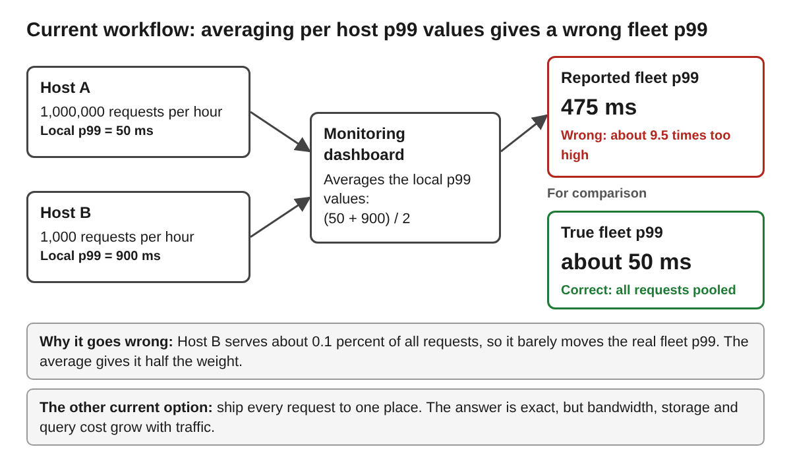

# Approximation First Telemetry with Mergeable Quantile Summaries

**Author:** Zihad Patwary  
**Course:** CSC 59866  
**Selected project and option:** NSF project 04, Approximation First Telemetry for Hyperscale Networked Systems (course slot to confirm: A04, A16 or Own Project)  
**Current assignment:** 1  
**Friday commit deadline:** November 6, 2026, at 11:59 p.m. New York time  
**Monday presentation:** November 9, 2026, at 6:30 p.m. New York time  
**Last updated:** November 6, 2026  
**Document status:** Proposed

## Progress note

This first version moves my proposal into the design template. Section 1 explains who is affected, how fleet level latency is reported today, a concrete example with numbers, and which evidence is documented, observed or assumed.

I narrowed the full proposal to one question for this semester: when request latencies are split across simulated hosts with very different loads, how far off is an averaged per host p99, and how close do merged DDSketch summaries get, at what memory, compared with the exact answer?

The example needs one fixed definition of error before any methods can be compared, so Section 1 uses relative error at p99: the gap between an estimate and the exact p99, divided by the exact p99. The main thing I still need is realistic data, because invented latencies may not show real skew. My next step is to write the Section 2 requirements and compare the approaches in Section 3.

## 1 Problem research and scope

**Problem and affected people:** Operators watch the speed of a service across many servers, and the number they usually want is the fleet p99: the latency that 99 percent of all requests beat. Each host can compute its own p99 cheaply, but a fleet p99 cannot be rebuilt from those local values. The other way to get it right is to send every request to one place, which costs bandwidth, storage and query time. This project asks how small mergeable summaries can answer the fleet question accurately without moving all the data.

| Stakeholder | Need | Problem today |
|---|---|---|
| Reliability engineer on call | A trustworthy fleet p99 quickly | An averaged p99 can hide a slowdown or invent one |
| Monitoring platform team | Low network, storage and query cost | Keeping every request is accurate but expensive |
| Users of the monitored service | Problems found and fixed fast | A wrong or late number delays the fix |

**Current workflow:**

1. Each host records the latency of every request it serves.
2. A monitoring agent on the host either computes a local p99 or ships the raw measurements.
3. A central system combines the results, either by averaging the local p99 values or by storing and scanning all raw data.
4. A dashboard or alert shows the fleet p99.
5. An engineer decides whether to act. The difficulty is step 3: averaging is cheap but wrong, and keeping everything is right but costly.

I have not observed a specific company's pipeline. The workflow above is a simplified picture built from the sources listed under Evidence.

**Scenario:** Two hosts serve one hour of traffic. Host A serves 1,000,000 requests and its local p99 is 50 ms. Host B serves 1,000 requests and its local p99 is 900 ms. A dashboard averages the two local values and reports (50 + 900) / 2 = 475 ms. Because Host B handles only about 0.1 percent of the requests, the real fleet p99 stays close to Host A's, about 50 ms. The report is roughly 9.5 times too high, and an engineer may chase a slowdown that is not there. The numbers are chosen for illustration, not measured. The opposite error is also possible when a busy host hides a small slow one.

**Figure 1.** The current workflow in this example. The average treats a host with 1,000 requests the same as a host with 1,000,000, so the reported fleet p99 is far from the true value.

**Evidence:**

* *Documented:* Prometheus's guidance says aggregating the precomputed quantiles from a summary rarely makes sense, while histograms can be aggregated at query time ([Prometheus documentation](https://prometheus.io/docs/practices/histograms/)). This documents that percentile values do not combine across hosts, though not how often it causes a wrong decision.
* *Documented:* The DDSketch paper reports that rank error guarantees can still allow large relative errors on heavily skewed data, and presents a sketch that is fully mergeable with a relative error guarantee ([Masson et al., 2019](https://www.vldb.org/pvldb/vol12/p2195-masson.pdf)).
* *Documented:* The abstract of NSF award 2544434 says telemetry data can be too large to analyze in full when operators need real time answers, and names mergeable summaries that track uncertainty as its first research thrust ([NSF award 2544434](https://www.nsf.gov/awardsearch/show-award?AWD_ID=2544434)). This shows the problem is funded research, not that my specific case occurs.
* *Observed:* None yet. The scenario is an illustration and I have not run an experiment.
* *Assumed:* Real host loads are uneven enough that averaged p99 values mislead, and merged sketches stay close to the exact answer at a small memory size. Both must be tested.

**Small capability this semester:** I will build a small Python simulation that splits one latency stream across hosts with uneven loads. It will compare three ways of answering the fleet p99: the average of per host p99 values, a uniform random sample, and merged DDSketch summaries. Each will be measured against the exact p99 computed from all the data, using relative error at p99, and reported at several memory sizes.

**Larger goal for Semester II:** A decision guide for which summary suits which data shape. It will add KLL and t digest sketches, one minimal mergeable sketch that I write and validate myself, a simple query layer, a merge study with more nodes and bursty, skewed data, and a second dataset.

**Exclusions:** This project does not include learned compression for long term storage, the configuration management engine, real network deployment, security monitoring, failure propagation across services, or any claim of true hyperscale. Scale is simulated by splitting data across nodes, and I will say so plainly.

## 2 Requirements and system specification

*Work to come in Assignment 2.*

## 3 Alternatives and selected solution

*Work to come in Assignments 2 to 3.*

## 4 Architectural design

*Work to come in Assignment 3.*

## 5 Component design and interfaces

*Work to come in Assignment 3.*

## 6 Data structure design

*Work to come in Assignment 4.*

## 7 Algorithm design and execution

*Work to come in Assignment 4.*

## 8 Failures and security

*Work to come in Assignment 4.*

## 9 Implementation and feasibility

*Work to come in Assignments 3 to 6.*

## 10 Testing and verification

*Work to come in Assignments 4 to 6.*

## 11 Operation maintenance and future work

*Work to come in Assignments 4 to 6.*

## 12 Revision history and references

### Revision history

| Date | Change |
|---|---|
| November 6, 2026 | First version: Section 1, progress note, open question and references. Sections 2 to 11 marked as work to come. |

### Open question

| Open question | Why it matters | Next action |
|---|---|---|
| Is there public data with per request latencies and uneven host loads? | Invented latencies may not show real skew, so the comparison could look better or worse than reality | Read the Alibaba microservices trace description for response time fields and license terms. If it does not fit, use synthetic skewed streams and label them as synthetic |

### References

* Prometheus. [Histograms and summaries](https://prometheus.io/docs/practices/histograms/). Existing approach: histograms can be aggregated across instances, summary quantiles rarely can.
* Masson, C., Rim, J. E., and Lee, H. K. [DDSketch: A fast and fully mergeable quantile sketch with relative error guarantees](https://www.vldb.org/pvldb/vol12/p2195-masson.pdf). PVLDB 12(12), 2019. The sketch I will test first.
* National Science Foundation. [Award 2544434, Approximation First Telemetry for Hyperscale Networked Systems](https://www.nsf.gov/awardsearch/show-award?AWD_ID=2544434). University of Maryland, College Park. Published research source.
* Alibaba. [Alibaba cluster trace program](https://github.com/alibaba/clusterdata). Possible source of public microservice response time data, to be checked.
