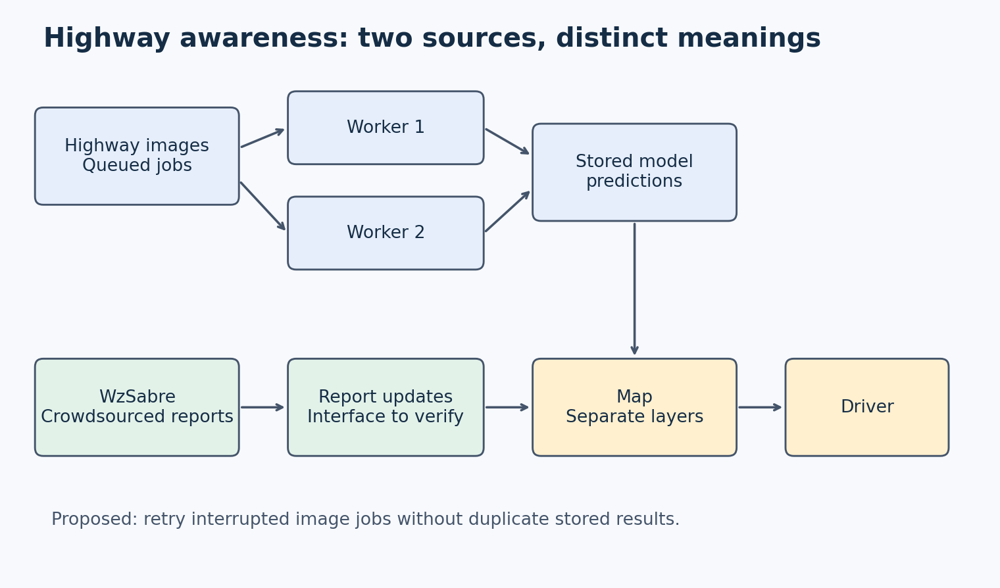
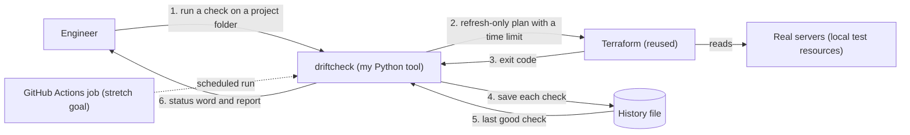
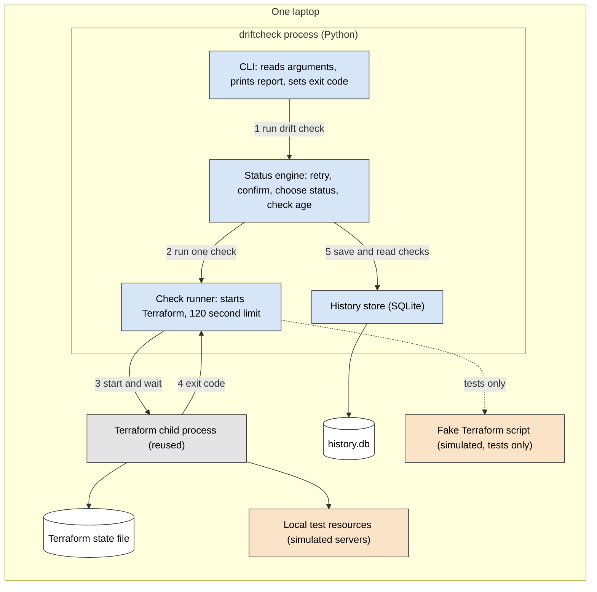

# **Trustworthy Drift Status for Terraform Projects**

**Author:** Benny Wen  
 **Course:** CSC 59866  
 **Selected project and option:** NSF project 06, "SHF: Small: Towards a Unified Approach for DevOps Configuration Drift Detection" (NSF award 2537321\)  
 **Current assignment:** 3  
 **Friday commit deadline:** November 20, 2026, at 11:59 p.m. New York time  
 **Monday presentation:** November 23, 2026, at 6:30 p.m. New York time  
 **Last updated:** November 20, 2026  
 **Document status:** Proposed

# Progress note

This is the third version of my design document. I chose Approach C. The checked wrapper because it is the only approach designed to meet the confirmation, retry, history, and never in sync after failure requirements. Section 3 has the selection and two decision records. Section 4 has a context view and an architecture view. Section 5 defines the critical operation, run_drift_check, and links it to F1 to F5, C1, and C2. Section 9 has the smallest build path and two experiments. E1 showed that a timed out check is stopped and that saved history survives a killed process. E2 showed that a refresh only plan returns exit code 2 when a resource is deleted outside Terraform. The main open issue is that I only tested one kind of drift. Next week I will test other kinds in Assignment 4.

# Contents

1. Problem research and scope
2. Requirements and system specification
3. Alternatives and selected solution
4. Architectural design
5. Component design and interfaces
6. Data structure design
7. Algorithm design and execution
8. Failures and security
9. Implementation and feasibility
10. Testing and verification
11. Operation maintenance and future work
12. Revision history and references

# 1 Problem research and scope

**Problem and affected people.** Development and Operations (DevOps) is how many software teams build an app, test it, and put it on real servers without doing each step by hand. The settings behind those steps live in configuration files, which are text files that define how things should be set up. Those files must keep matching the code and the real servers. Configuration drift is when they slowly stop matching, because of software changes, environment changes, mistakes, or unknown errors. Think of the files as recipe cards and the servers as the kitchen. Drift is when someone changes the kitchen and never updates the recipe cards. The National Science Foundation (NSF) award associated with this problem is https://www.nsf.gov/awardsearch/show-award?AWD_ID=2537321.

Teams use a drift check to catch this. A drift check is a program that compares the files to the real servers and reports any differences. To do that, it has to look at the real servers, and that look can go wrong for a lot of reasons. The connection can drop, the same look can be sent twice, or the answer can be old. The problem is what a drift check should report when its look goes wrong.

**Problem statement.** In one sentence, the problem is that a drift check can report that nothing has changed when it never got a successful look at the real servers. A good answer for a team is a check that says in sync only after a successful look, and says unknown otherwise.

**Concrete scenario.** Many teams describe their servers and networks in files instead of setting them up by hand. This is called infrastructure as code (IaC). One tool for this is Terraform, made by HashiCorp. HashiCorp's tutorial builds a virtual machine, which is a computer rented from a cloud company, and gives it a security group, which is a set of network rules that decides who can log in. A person then swaps that group for a different one by hand, outside the files. Terraform has a check called a refresh only plan. It reads the real machine and shows the old group removed and the new group added ("Manage Resource Drift"). This is the normal behavior of IaC. https://developer.hashicorp.com/terraform/tutorials/state/resource-drift

Here comes the problem. In one case, the connection to the cloud is lost and no answer comes back. In another, a retry sends the same request twice and the two answers differ. In a third, the answer is outdated and still shows the old security group, so the check says nothing changed while the real machine has different rules. I have not documented that Terraform does this. But a research paper titled "Robust Infrastructure by Verification Agents" (RIVA) says that when tools give incomplete, stale, or misleading output, an automated agent may conclude a system is healthy even though drift has occurred (Abuzakuk et al., sec. 2.3). Its agents run on large language models (LLMs), which are artificial intelligence programs that work with text. https://arxiv.org/pdf/2603.02345

**Boundaries.** I will focus on one tool, Terraform. The question I am scoping in on is whether its drift check can be trusted when a reading is lost, repeated, or outdated. I will not try to stop drift from occurring or to repair it (tentative).

**Current workflow.**

1. A team describes its servers in Terraform files.
2. Someone changes a server by hand, so the real server no longer matches the files.
3. An engineer runs Terraform's refresh-only plan, which reads the real server.
4. The engineer reads the output and decides whether anything drifted.
5. The engineer fixes the server or updates the files.

The difficulty occurs at step 3. If the reading is lost, repeated, or outdated, the output in step 4 may be wrong or missing, and the engineer has no clear way to tell.

**Workflow Diagram.** Configuration files and real servers both feed a drift check that produces a report of in sync, drifted, or unknown. Three places the reading from the real servers can go wrong, which are a lost connection, a repeated request, and an old answer.

The drift check compares what should exist with what exists now. The reading from the real servers is the step my project focuses on, and it can fail in three ways.

**Who or what is affected.** The engineers who run the environment are affected first. For example, an engineer wants remote login to stay limited to approved rules. If an outdated reading hides the swap, the machine keeps the wrong rules and nobody knows. If a lost reading makes the checker report drift that is not real, the engineer may try to fix something that isn't broken. The Terraform tutorial warns that when state and configuration do not match the infrastructure, Terraform will try to reconcile them and may unintentionally destroy or recreate resources ("Manage Resource Drift"). So a false alarm can lead to a real change, and a missed alarm can leave a real problem in place.

Organizations that depend on these systems are affected too. The NSF abstract names healthcare, transportation, and technology as critical sectors that need reliable software, and it says the project aims to reduce the burden on developers. That is the NSF's claim about the project.

| Stakeholder | What they need | Basis |
|---|---|---|
| Engineers who maintain Terraform projects | A drift result they can trust, with a clear "unknown" when the check could not finish | Documented. The NSF abstract says the project aims to reduce the burden on developers who maintain these systems |
| Teams and organizations that depend on these systems | Reliable software and fewer failures and delays | Documented. The NSF abstract names healthcare, transportation, and technology as critical sectors. This is the NSF's claim about its whole project, not evidence about my case |
| Engineers who read a scheduled report | A short status that says how old the last good check is | Assumed. I have not confirmed how teams use such reports |

**Evidence.**

*Documented.* The NSF abstract says drift leads to system failures, delays, and more maintenance effort ("SHF"). HashiCorp's older guide says drift can come from changes made by hand or by other automation tools (Koehler). The RIVA authors say drift comes from bugs, manual changes, or system updates, and that checking for it is labor intensive and error prone (Abuzakuk et al., abstract and sec. 1). In their tests on a benchmark called AIOpsLab, one tool silently returning wrong data lowered detection success from 50% to 40% and success at finding where the problem was from 22.2% to 11.1% (Abuzakuk et al., sec. 1). Those numbers come from LLM agents on a benchmark, not from Terraform or CloudFormation. https://www.hashicorp.com/blog/detecting-and-managing-drift-with-terraform

*New since the first version.* HashiCorp's official page for the plan command now confirms what the detailed exit code option does. Exit code 0 means the plan succeeded with no changes, exit code 1 means an error, and exit code 2 means it succeeded with changes present. The same page describes refresh-only mode as a plan whose goal is only to update Terraform's state to match changes made to remote objects outside Terraform. It says this mode is available from Terraform 0.15.4. It also says a plan alone does not carry out the proposed changes. If Terraform cannot get the state lock, it retries for the lock timeout, if one is set, and then returns an error. HashiCorp's machine-readable output reference adds a second signal. With the JSON option (JSON is a text format programs use to exchange data), if drift is detected during planning, Terraform emits a resource_drift message for each resource that changed outside Terraform. Neither page says what exit code a refresh-only plan returns when it finds drift. https://developer.hashicorp.com/terraform/cli/commands/plan

https://developer.hashicorp.com/terraform/internals/machine-readable-ui

*Observed.* I have no observations of this problem in software development, since my experience with DevOps is limited. I have not built or measured anything yet.

*Assumed.* I assume lost, repeated, and outdated readings happen often enough in real Terraform use to matter. I assume a refresh-only plan run with the detailed exit code option returns exit code 2 when it finds drift. HashiCorp documents the exit codes in general, but not for refresh-only plans, so I will test it. None of this has been proven as of now. **Update for Assignment 3:** I ran the test (E2 in Section 9.3), and it returned exit code 2 for a resource deleted outside Terraform.

*Missing evidence.* I have not found data on how often drift checkers get failed or outdated readings. The NSF award is still active, but I haven't found any large studies that have produced results yet. The Amazon Web Services (AWS) CloudFormation guide is related evidence that a drift check can fail to finish, because it has a status for that case (see Section 3). https://docs.aws.amazon.com/AWSCloudFormation/latest/UserGuide/using-cfn-stack-drift.html

**Six-week contribution.** For the first six weeks I will build the smallest working version of my tool. It checks one Terraform project by running the refresh-only plan and reports one of three answers, in sync, drifted, or unknown. If Terraform fails or cannot reach the cloud, the tool says unknown and never in sync. It never changes any infrastructure.

**Semester II scope.** I will build a small command line tool for the people who maintain Terraform projects, the same engineers the sources describe as carrying the burden of drift. Because reading is safe to repeat, the full version retries a failed check a limited number of times and asks for two matching results before it says in sync. It saves the time and result of every check, so the report shows when the last good check happened and warns when that result is too old to trust. I will also include a scheduled job file for GitHub Actions, an automation service, so a team can run the check automatically.

The comparison I will make is between running the refresh only plan by hand and running my tool, on the same small real Terraform project and the same four situations, which are a change made outside Terraform, a failed run, a repeated run, and an old result. I will judge each by correctness. I expect to use Python, the free Terraform program, and a free local setup. For tests, a fake Terraform stand in will return the exit codes I choose.

My solution direction is tentative. The three answers, the retry rule, and the age warning are my first design, and feedback from real users may change them. The work is manageable for one student because it wraps one existing command, needs little code, and needs no paid cloud account. Each feature answers one problem in my paper. Unknown and retries cover a lost reading, two matching results cover a repeated reading, and the age warning covers an outdated reading.

**Exclusions.** I will exclude every tool other than Terraform, source code and application drift, LLM agents, automatic repair, and a web dashboard.

**What I still don't know.** HashiCorp's documentation says exit code 1 is an error and exit code 2 means changes are present. So in general, a wrapper, which is a tool that runs Terraform and reads its results, can tell a failed check from a changed one. What I do not know is whether that holds for a refresh-only plan that finds drift. I also do not know whether real Terraform users will understand the three answers my tool gives.

To answer this, I have read HashiCorp's official page for the plan command, which confirms what exit codes 0, 1, and 2 mean. It does not say what a refresh-only plan returns when it finds drift. My first test is to run a refresh-only plan with the detailed exit code option on a small project, change a resource by hand, and write down the exit code. If it returns 2, the tool can use exit codes. If it does not, I will read the machine-readable output for resource_drift messages instead. Second, as I build, I will try the tool on small real Terraform projects to see what it reports when Terraform fails, repeats a check, or gives an old result. If users misunderstand the unknown answer, I would change its wording and the report layout.

**Update for Assignment 3.** I ran the first test on a small project. The results are in Section 9.3. The exit code was 2 when a resource was changed outside Terraform, so the tool can use exit codes.

# 2 Requirements and system specification

This section says what the tool must do, in behavior a person can observe. It does not say how the tool is built. Requirement IDs, which are short labels for each requirement, follow the course scheme. F means a functional requirement, which describes what the tool does. C means a correctness rule, which describes something that must always be true. Q means a quality target. A value marked proposed has not been measured and may change.

**Words used in this section.** A check is one run of Terraform's refresh-only plan with the detailed exit code option. A good check is a check that ends with exit code 0, which means no changes, or exit code 2, which means changes are present. A failed check is anything else, such as exit code 1, a lock error, a run that takes longer than the time limit, or Terraform not starting. A fake Terraform is a small stand-in program that returns the exit codes I choose and logs every command it receives, so I can test without a cloud account.

## 2.1 What the tool must do

| ID | Type | Requirement | Acceptance check |
|---|---|---|---|
| F1 | Functional | For one project folder, the tool runs one check and records its exit code and the time it ran. The check uses the refresh-only option, the detailed exit code option, and the option that turns off prompts for input variables, so an automated run does not stop to ask a question. | The fake Terraform returns 0. Its log shows one command with those three options, and the tool saved code 0 with a time. |
| F2 | Functional | After checking, the tool prints exactly one status word, which is in sync, drifted, or unknown. | For every fake result in Section 2.2, the output has exactly one status word, and it matches the table. |
| F3 | Functional | If a check fails, the tool runs another check. It stops and reports unknown after 3 failed checks in a row. It also stops after 6 checks in total. Both limits are proposed. A check that runs longer than 120 seconds (proposed) counts as failed. | The fake returns 1 every time. The fake was run exactly 3 times and the status is unknown. The fake returns 0, 1, 0, 1, 0, 1. The fake was run exactly 6 times and the status is unknown. |
| F4 | Functional | A good check with exit code 2 gives drifted right away. A good check with exit code 0 needs the very next check to also be 0, and two 0 results in a row give in sync. If the next check is 2, the status is unknown, because the checks disagreed. If the next check fails, the earlier 0 no longer counts and the tool keeps going under F3. | The fake returns 2, which gives drifted. It returns 0 then 0, which gives in sync. It returns 0 then 2, which gives unknown. It returns 0, 1, 0, 0, which gives in sync, because the failure reset the count. |
| F5 | Functional | The tool saves the time and result of every check. The report shows the time of the last good check and says too old when that check is more than 24 hours old (proposed). | A saved good check is 30 hours old and the new run fails 3 times. The report shows that time and the words too old. A saved good check is 1 hour old, so the report does not say too old. The saved record is still there after the tool is closed and run again. |
| C1 | Correctness rule | The tool reports in sync only when its final two checks both ended with exit code 0. A failed or disagreeing check never produces in sync. | Run every sequence of up to 6 fake results using 0, 1, 2, and a timeout. Whenever the output is in sync, the final two results were both 0. |
| C2 | Correctness rule | The tool never changes infrastructure or Terraform's record of it. It only runs the refresh-only plan. | The fake Terraform logs every command it receives. In all tests, each command is a plan with the refresh-only option. None is an apply, a refresh, or a destroy. |
| Q1 | Quality target (proposed, not measured) | In at least 100 randomized runs, the tool reports in sync falsely 0 times. Each run uses the fake Terraform with a random sequence of 0, 1, 2, and timeouts. A run that times out stays in the 100 runs. | Count the runs where the output is in sync but the final two fake results were not both 0. The count must be 0. |

## 2.2 Examples

An ordinary case and some unsuccessful cases, using the fake Terraform. Results are listed in the order the fake returns them.

| Fake Terraform results | Expected output |
|---|---|
| 0, then 0 (ordinary case) | Status: in sync. Two checks agree. Last good check: now. |
| 2 | Status: drifted. Terraform reported changes. Last good check: now. |
| 0, then 2 | Status: unknown. The two checks disagreed. |
| 1, then 1, then 1 | Status: unknown. Terraform failed 3 times. The report shows the last good check and its age. |
| 1, then 0, then 0 | Status: in sync. The first check failed, but the final two checks agree. |
| 0, then 1, then 0, then 0 | Status: in sync. The failure reset the count, and the final two checks agree. |
| 0, 1, 0, 1, 0, 1 | Status: unknown. The limit of 6 checks was reached without two 0 results in a row. |
| 1, then 1, then 1, with a message that the state is locked | Status: unknown. Another run held the lock. |
| Terraform cannot start | Status: unknown. Terraform did not run. |
| Saved good check is 30 hours old, then 1, 1, 1 | Status: unknown. Last good check 30 hours ago, too old to trust. |

## 2.3 What the documentation already establishes

- **Exit codes.** With the detailed exit code option, exit code 0 means succeeded with no changes, 1 means error, and 2 means succeeded with changes present. HashiCorp's plan command page.
- **Refresh-only mode.** A plan in this mode only updates Terraform's state to match changes made outside Terraform. It needs Terraform 0.15.4 or later, and a plan alone does not carry out changes. HashiCorp's plan command page.
- **Locking.** A state lock stops two runs from changing the same state at once. Terraform holds the lock during a plan unless locking is turned off. If a lock timeout is set, Terraform retries for that time and then returns an error. HashiCorp's plan command page.
- **Machine-readable output.** With the JSON option, Terraform emits a resource_drift message for each resource that changed outside Terraform when drift is detected during planning. HashiCorp's machine-readable output reference.

## 2.4 Assumptions

| ID | Assumption | How I will check it |
|---|---|---|
| A1 | A refresh-only plan with the detailed exit code option returns exit code 2 when something was changed outside Terraform. The documentation gives the exit codes in general but not for this mode. If it is wrong, F4 has to change, and I would read resource_drift messages from the JSON output instead. | Run it on a small project, change a resource by hand, and write down the exit code. Tested in E2 (Section 9.3). It returned 2 for a deleted local file on Terraform v1.17.2. |
| A2 | Running a refresh-only plan again is safe, because a plan alone does not carry out changes. It could still be slowed by a lock or by limits on a cloud service. | Run it twice in a row on the test project and compare the results and the saved state. Tested in E2. Both runs gave the same exit code and output, and the state file was unchanged. |
| A3 | The test project is small and uses resources that can run on my own computer, so no paid cloud account is needed. | Pick the resources and confirm the project runs before building the tool. |
| A4 | One person runs the tool on one computer, and nobody else is changing the same project during a check. | Test with one user only. Treat a held lock as a failed check, as in the examples. |
| A5 | The JSON output reports resource_drift messages in refresh-only mode. The reference says this when drift is detected during planning, but it does not name refresh-only mode. | Run the JSON option on the same hand-changed project and look for a resource_drift message. Tested in E2. The JSON output had one resource_drift line for the deleted file. |

## 2.5 Constraints

- The tool works with Terraform only, version 0.15.4 or later, which is when refresh-only mode became available.
- It is a command line tool written in Python.
- It uses free tools and no paid cloud account.
- It is built by one student in one semester.
- Terraform must be installed on the same computer.
- The scheduled job file for GitHub Actions is a stretch goal and not required here.

## 2.6 Not yet specified

These values are all proposed. They are the limit of 3 failed checks in a row, the limit of 6 checks in total, the time limit of 120 seconds for one check, the age limit of 24 hours, and the 100 randomized runs. I will adjust them after I test on a small project.

# 3 Alternatives and selected solution

This section compares four approaches against the same requirements and ends with the approach I selected and two decision records. In the table, each entry says its basis. Documented means a source states it. Judgment means it is my own reasoning. By design means the approach is meant to meet the requirement but has not been built or tested. Not described means the pages I read do not say.

**Approach A, the baseline. An engineer runs the refresh-only plan by hand.** Terraform keeps a state file, which is its record of the resources it manages. On a plan, it updates that record from the real infrastructure, and the refresh-only option shows what would change in the record without touching the infrastructure ("Manage Resource Drift"). HashiCorp's plan page says a plan alone does not carry out the proposed changes, and the tutorial calls the refresh-only plan safer than the older refresh command, which overwrites the state file without showing the updates. The strength is a read-only view of exactly which settings differ. The limits are that Terraform only refreshes resources under its management (Koehler), and the tutorial notes that without a saved plan file, Terraform cannot guarantee that a later apply will take exactly the shown actions ("Manage Resource Drift"). The pages I read do not say what happens when a reading is lost or outdated. A person has to notice and judge. https://developer.hashicorp.com/terraform/tutorials/state/resource-drift

**Approach B. A one-shot wrapper.** This is a simple script that runs the check once and turns the exit code into a status. Exit code 0 becomes in sync, 2 becomes drifted, and anything else becomes unknown. This is my own simple candidate, based on the documented exit codes. Its strength is that it is very small and gives one plain word. Its limit is that one good check is enough for in sync, so it does not meet F4 or C1. It also remembers nothing between runs, so it does not meet F5.

**Approach C. A checked wrapper.** This is Approach B plus retries, two matching checks before in sync, and a saved history with an age warning. It is the design my paper proposes. By design, it is meant to meet F1 to F5, C1, and C2. It has not been built or tested. Its limits are that it takes more code than B, and that its retry and age limits are guesses until I test them. A variation is to also read the resource_drift messages from the JSON output as a second signal, which would echo the cross-checking idea in the RIVA research below. I decided how to handle that variation in Decision 1 at the end of this section.

**Approach D. AWS CloudFormation drift detection.** AWS stands for Amazon Web Services, Amazon's cloud service, and CloudFormation is its own way to describe servers in files, called templates. A drift detection operation compares what a template says should exist with what exists now, for each resource that supports drift detection. Its status model is richer than most. The operation status can be DETECTION_IN_PROGRESS, DETECTION_COMPLETE, or DETECTION_FAILED, and failed means detection failed for at least one resource while results are still available for the others. The stack status can be DRIFTED, IN_SYNC, UNKNOWN, or NOT_CHECKED, where UNKNOWN means CloudFormation could not run drift detection for a resource. It also records when detection started, and each resource can carry a last check time, which is optional (DescribeStackDriftDetectionStatus; StackResourceDriftInformation). These come from AWS's API reference. An API, or application programming interface, is the way one program asks a service to do something. It has limits for this project. DETECTION_COMPLETE covers only the resources that support drift detection, and the rest remain unchecked. I did not see retries or an age warning described. It also cannot check Terraform projects. The CloudFormation guide I cited in Section 1 also says it only checks properties the template sets explicitly and does not check stacks nested inside other stacks ("Detect Unmanaged"). I include D for its status model. https://docs.aws.amazon.com/AWSCloudFormation/latest/UserGuide/using-cfn-stack-drift.html

**A research approach, RIVA, is not in the table.** Its main idea is that two tool calls with the same goal are unlikely to both be wrong. So it checks each property through different tools and compares them (Abuzakuk et al., sec. 1). When some of its tools returned wrong data, it raised average task success from 27.3% to 50%. It depends on LLMs, each task was run only 5 times, and the authors say the benchmark gave too few diagnostic paths (Abuzakuk et al., secs. 4.4, 7). I excluded LLM agents from my scope, so I use RIVA only as support for the idea behind F4, which is to confirm a result before trusting it. https://arxiv.org/pdf/2603.02345

## Comparison against the requirements

| Requirement | A. Manual refresh-only plan | B. One-shot wrapper | C. Checked wrapper | D. CloudFormation drift detection |
|---|---|---|---|---|
| F1 Run one check without prompts | Yes. A person types the command (judgment) | Yes (by design) | Yes (by design) | Not for Terraform |
| F2 One of three status words | No. A person reads the output (judgment) | Yes (by design) | Yes (by design) | Partly. Statuses include IN_SYNC, DRIFTED, UNKNOWN, and NOT_CHECKED (documented) |
| F3 Retry a failed check | No (judgment) | No (by design) | Yes (by design) | Not described |
| F4 Confirm before in sync | No (judgment) | No (by design) | Yes (by design) | Not described |
| F5 Remember the last good check and its age | No (judgment) | No (by design) | Yes (by design) | Partly. Records when detection started and an optional per-resource last check time. No age warning described (documented) |
| C1 Never in sync after a failure | Depends on the person (judgment) | No (by design) | Yes (by design) | Partly. Has UNKNOWN and DETECTION_FAILED, but DETECTION_COMPLETE leaves unsupported resources unchecked (documented) |
| C2 Read-only | Yes. A plan alone does not carry out changes (documented) | Yes (by design) | Yes (by design) | Not described |
| Q1 Zero false in sync | Not measured | Not measured | Not measured | Not measured |

The requirements that best separate the approaches are F4, F5, and C1. Approaches A and B both fail them, and C is the only one designed to meet all three. D comes closest on the status model, since it has an unknown-style status and records a time, but it does not describe confirming a result or warning about age. If I had to separate B from C, I would test the sequence "0, then 2", because B reports in sync after the first 0 and C reports unknown.

**What I did not find.** None of the pages I read describe a ready tool that gives a small team one plain status, in sync, drifted, or unknown, with the age of the last good check. I did not search for open source tools beyond these pages, so I cannot say none exist.

## Selected solution

I am selecting Approach C, the checked wrapper, built as a Python command line tool. My working name for it is driftcheck. It runs Terraform's refresh-only plan, retries a failed check, asks for two matching good checks before it says in sync, and saves every check so it can show the age of the last good check.

**Why C.** The comparison table shows that F4, F5, and C1 are the requirements that separate the approaches, and C is the only one designed to meet all three. Approach B is too weak, because one good check is enough for in sync, so a single lucky or old result passes. Approach A leaves the judgment to a person, which is the exact problem my project is about. Approach D only works for CloudFormation, so it cannot check a Terraform project and fails F1. C also fits my limits. It wraps one existing command, needs no paid cloud account, and can be tested with the fake Terraform. This is a design judgment based on the table. I have not built or measured C, and Q1 is still not measured.

### Decision 1: Which approach to build, and which signal it reads

**Context.** My problem is that a drift check can say nothing changed when it never got a good look at the real servers (Section 1). The requirements need a status that is never in sync after a failed or disagreeing check (C1), a retry rule (F3), and a saved history (F5). Terraform's exit codes are documented in general, but at first I did not know what a refresh-only plan returns when it finds drift (A1). I tested that later in E2 (Section 9.3).

**Options.**

1. Approach A, run the plan by hand.
2. Approach B, a one-shot wrapper.
3. Approach C using only the exit code as its signal.
4. Approach C using the exit code and also the resource_drift messages from the JSON output as a second signal.

**Choice.** Approach C using only the exit code for the first working path. The JSON output stays as a fallback for A1.

**Reasons.** Options 1 and 2 cannot meet F4, F5, and C1, as the comparison table shows. Between options 3 and 4, the exit code is the simplest signal, and it is documented in general (HashiCorp plan page). Reading the JSON output means parsing a stream of messages, which is more code, and at that point I did not know whether A5 holds in refresh-only mode (E2 later showed it does for a deleted resource). Starting with one signal keeps the first path small and easy to test with the fake Terraform.

**Consequences.** The tool depends on A1. E2 confirmed it for one kind of drift, a deleted local file, but other kinds are not tested yet. If a refresh-only plan does not return exit code 2 for some kind of drift, the first path will have a wrong signal. The retry and confirm rules add a cost. With the proposed limits, the worst case is 6 checks of up to 120 seconds each, which is 6 x 120 = 720 seconds, or 12 minutes, before the tool gives up with unknown. The tool also needs more code than Approach B.

**Reconsider if.** A later test shows that a refresh-only plan does not return exit code 2 for some kind of drift. Then I switch the signal to resource_drift messages, which is option 4 without the exit code for drift. I would also reconsider if a real project makes the worst case of 12 minutes too slow, or if test users misread the unknown status.

### Decision 2: Where to save the check history

**Context.** F5 needs the time and result of every check to be saved and still there after the tool is closed and run again. A check can be cut short by a time limit or a crash, so a saved check should not be half written.

**Options.**

1. A JSON Lines text file, with one line added per check.
2. An SQLite database file, used through Python's sqlite3 module.
3. Terraform's own state file.

**Choice.** An SQLite database file.

**Reasons.** SQLite's documentation says that all changes in one transaction either happen completely or not at all, even if the program crashes, the operating system crashes, or the power fails (SQLite, "SQLite Is Transactional"). A text file written line by line could end with a half written line after a crash, and I would have to write my own code to detect that. Python's documentation describes the sqlite3 module as an interface to a disk-based SQLite database, and it says saved data stays after the Python interpreter restarts (Python sqlite3). Option 3 is out because C2 says the tool never changes Terraform's record of the infrastructure. I also tested this choice with a small experiment, described in Section 9 (E1).

**Consequences.** The history file is in a binary format, so I need a SQLite tool or a small Python script to look inside it. I have to design the table in Assignment 4. The Python documentation calls the sqlite3 module optional, so a Python build might not include it. I assume it is there on my computer. I also assume one tool run at a time (A4).

**Reconsider if.** A reviewer or user needs to read the history without a tool. Then I would switch to a JSON Lines file and add a check for half written lines. I would also reconsider if the scheduled job in the stretch goal cannot keep a local file between runs, which I would need to check.

# 4 Architectural design

This section shows the tool from the outside first, then from the inside. The tool, driftcheck, is one Python program that starts Terraform as a separate process and saves its checks in one file. Everything runs on one computer. I made two diagrams, and each one is explained below it.

## 4.1 Context view



**Figure 1.** The context view, drawn in Mermaid. The engineer is the only person who uses the tool. The dashed GitHub Actions box is a stretch goal and is not part of the first working path.

What I control is driftcheck and its history file. Terraform and the real servers belong to other parties, so I can only use them through their documented behavior. These are the things that cross each boundary.

| Arrow | From and to | What is sent |
|---|---|---|
| 1 | Engineer to driftcheck | A project folder to check, and optionally the history file and the Terraform program to use |
| 2 | driftcheck to Terraform | A refresh-only plan command with the detailed exit code option and prompts turned off, with a time limit |
| 3 | Terraform to driftcheck | An exit code (0, 1, or 2) and text output |
| 4 and 5 | driftcheck and the history file | One saved record per check, and a read of the last good check |
| 6 | driftcheck to engineer | One status word and a short report |

## 4.2 Architecture view



**Figure 2.** The architecture view, drawn in Mermaid. Blue boxes are parts I build, gray is reused, and orange is simulated. White boxes are saved state. The dashed arrow is only used in tests. The numbers match the trace in Section 4.3.

| Part | Responsibility | Where it runs | Saved state | Build, reuse, or simulate |
|---|---|---|---|---|
| CLI | Read the command line, call the status engine, print the report, set the exit code | Inside the driftcheck process | None | Build |
| Status engine | Decide the retry, confirm, and status rules (F3, F4, C1) and check the age of the last good check (F5) | Inside the driftcheck process | None, it only holds the checks of the current run in memory | Build |
| Check runner | Start one Terraform check, apply the time limit, and return the exit code and time | Inside the driftcheck process, starting a child process | None | Build |
| History store | Save every check and read the last good one | Inside the driftcheck process | history.db on disk | Build, using Python's sqlite3 module and SQLite (reused) |
| Terraform | Run the refresh-only plan and report an exit code | A child process on the same computer | The Terraform state file, which Terraform keeps | Reuse |
| Test project and local resources | Give Terraform something to read, so I need no cloud account | Files on the same computer | Their own files | Simulate. They stand in for real servers |
| Fake Terraform | Return the exit codes I choose and log every command it receives, for tests | A small script on the same computer | A command log file | Simulate. It stands in for Terraform |

**Communication.** The parts inside the driftcheck process talk by ordinary function calls. They do not use a network. The only separate process is Terraform, which the check runner starts and waits for, and the only messages are the command line it sends and the exit code and text it gets back. The runner is the only part that waits on something outside the program, so it is the only part with a time limit.

**Where things run and saved state.** I decided to run everything on one computer. That means the history file and the Terraform state are both single points of failure. If the disk is lost, the history is lost, and the tool makes no recovery claim for that. The only state I save is history.db. The status engine keeps the current run in memory, which is lost if the process stops, and that is fine because a new run starts again from the first check.

**Why one program and not several services.** A service boundary adds messages, setup, and new ways to fail. The CLI, the status engine, the check runner, and the history store can all be modules in one program, so I did not split them into services. This is my own design judgment.

**How this connects to partial failure.** In this design, a timeout means driftcheck stopped waiting. It does not tell me whether Terraform finished reading the real servers. Because a refresh-only plan alone does not carry out changes (HashiCorp plan page), repeating the check is safe, which is assumption A2. E2 supported it for a deleted local file, but not for a lost connection or a held lock. So the tool does not need a request ID like the booking example in the course handbook. It only needs to treat a timeout as a failed check and ask again.

**What I build, reuse, and simulate.** I build the four parts inside the driftcheck process. I reuse Terraform, SQLite, and Python's standard library. I simulate the real servers with local test resources, and I simulate Terraform with the fake script when I want to control the exit codes. These simulations have limits. The fake Terraform only tests my rules, so it says nothing about how real Terraform behaves. The local resources do not show cloud network failures.

## 4.3 Tracing one request

This traces one run of `driftcheck PROJECT_DIR` where the fake Terraform returns 0 and then 0 (the ordinary case in Section 2.2). The numbers match Figure 2.

1. The CLI reads the arguments and asks the status engine to run a drift check.
2. The status engine asks the check runner for one check.
3. The check runner starts Terraform with the refresh-only plan, the detailed exit code option, and prompts turned off, and waits up to 120 seconds.
4. Terraform returns exit code 0. The runner gives the exit code and time back to the status engine.
5. The status engine asks the history store to save the check, then runs a second check the same way, because one 0 is not enough. Both checks return 0, so the engine decides in sync. It reads the last good check from the history store for the report.
6. The CLI prints the status word and the report and exits with code 0.

# 5 Component design and interfaces

## 5.1 Component responsibilities

| Component | Responsibility | Information it needs | Result it produces | Requirements |
|---|---|---|---|---|
| CLI | Read the arguments, call the status engine, print the report, and set the tool's exit code | Command line arguments | The printed report and an exit code | F2 |
| Status engine | Run checks until it can decide, then choose the status word and the age warning | The check runner, the history store, and the proposed limits (3 failed in a row, 6 total, 24 hours) | A status word, a reason, the count of checks, and the last good check | F2, F3, F4, F5, C1 |
| Check runner | Run exactly one Terraform check with the three options and the 120 second limit | Project folder, Terraform program, time limit | The exit code and time, or a failed result if it timed out or Terraform did not start | F1, F3, C2 |
| History store | Save one record per check right after it ends, and read the last good check | History file path, a check record | A saved record, or the last good check, or nothing | F5 |
| Terraform | Run the refresh-only plan (reused) | Project folder and the three options | Exit code and text output | A1 |
| Fake Terraform | Return chosen exit codes and log commands (simulated, for tests) | A list of results to return | The exit codes and a command log | C2 |

## 5.2 Critical operation: run_drift_check

I chose this operation because the whole project depends on it. It is the one operation a user can ask the tool to do, and it covers F1 to F5, C1, and C2. The command line form is:

```text
driftcheck PROJECT_DIR [--history FILE] [--terraform PROGRAM]
```

In the code, the CLI calls `run_drift_check(project_dir, history_file, terraform_program)` in the status engine. In this version, the retry limits (3 failed in a row, 6 checks in total, 120 seconds per check, 24 hours for age) are fixed values, because they are all still proposed (Section 2.6).

**Inputs.**

| Input | Meaning and allowed values | Default |
|---|---|---|
| PROJECT_DIR | The folder that holds the Terraform files. It must exist and be a folder. I assume `terraform init` was already run there | None, it is required |
| --history FILE | The SQLite file that saves checks. It is created if it does not exist. It must be possible to open and write it | `.driftcheck/history.db` inside PROJECT_DIR (proposed) |
| --terraform PROGRAM | The program to run as Terraform. Tests point this at the fake Terraform | `terraform` |

**Output.** The tool prints four lines and sets its own exit code. The tool's exit codes are separate from Terraform's exit codes.

```text
Status: <in sync | drifted | unknown>
Reason: <one sentence>
Checks run: <number>
Last good check: <UTC time> (<age>)   or   none
```

The age line adds `too old to trust` when the last good check is more than 24 hours old. The tool's exit code is 0 for in sync, 10 for drifted, 20 for unknown, and 64 for a usage error. These numbers are my own proposal. The idea is that any status other than in sync stops an automated job.

**State changes.** Each check adds one record to the history file, right after that check ends and before the next one starts. This happens even when the check failed. Nothing else is changed. The tool does not change infrastructure or Terraform's record of it (C2). Terraform may hold its state lock for a moment during a plan, which is Terraform's own behavior (HashiCorp plan page). Which checks count toward a status uses only the checks of the current run. Earlier runs only supply the last good check for the age line. A good check is one that ended with exit code 0 or 2, as defined in Section 2.

**Outcomes and errors.**

| Outcome | When it happens | Tool exit code | What is saved | What the caller does |
|---|---|---|---|---|
| in sync | The final two checks both ended with exit code 0 | 0 | Every check of the run | Nothing, the project matched |
| drifted | A good check ended with exit code 2 | 10 | Every check of the run | Look at the real servers and the files |
| unknown, failures | 3 failed checks in a row, or 6 checks in total without two 0 results in a row | 20 | Every check, with failures marked | Read the reason, then fix Terraform or the connection and run again |
| unknown, disagreement | A 0 was followed by a 2 | 20 | Every check of the run | Run again. Do not trust either result alone |
| usage error | PROJECT_DIR is missing or not a folder, or the history file cannot be opened | 64 | Nothing, no check was run | Correct the arguments |

A check that runs longer than 120 seconds counts as failed, and Python's documentation says that when `subprocess.run` hits its timeout, the child process is killed and waited for (Python subprocess). A Terraform that cannot start counts as a failed check too.

**Concrete examples.** The values below are examples that show the format. They are not measured results.

Example 1, ordinary case. The fake Terraform returns 0 then 0.

```text
$ driftcheck ./project --terraform ./fake_terraform
Status: in sync
Reason: Two checks in a row agreed.
Checks run: 2
Last good check: 2026-11-20 15:00:03 UTC (just now)
```

The tool exits with 0. The history file gains these two records.

| Check | Started (UTC) | Exit code | Result |
|---|---|---|---|
| 1 | 2026-11-20 15:00:00 | 0 | no changes |
| 2 | 2026-11-20 15:00:03 | 0 | no changes |

Example 2, drift. The fake Terraform returns 2.

```text
Status: drifted
Reason: Terraform reported changes.
Checks run: 1
Last good check: 2026-11-19 15:10:00 UTC (just now)
```

The tool exits with 10.

Example 3, failure with an old saved check. The history file has a good check from 2026-11-19 09:00 UTC, and the fake Terraform returns 1, 1, 1.

```text
Status: unknown
Reason: Terraform failed 3 times in a row.
Checks run: 3
Last good check: 2026-11-19 09:00:00 UTC (30 hours ago, too old to trust)
```

The tool exits with 20. The three failed checks are saved too.

Example 4, usage error. The folder does not exist.

```text
$ driftcheck ./does-not-exist
Error: project folder not found: ./does-not-exist
```

The tool exits with 64. No status word is printed and nothing is saved.

**Link to requirements.** run_drift_check carries out F1 (the check runner), F2 (one status word), F3 and F4 (the status engine's retry and confirm rules), F5 (the history store and the age line), C1 (in sync only after two 0 results), and C2 (only the refresh-only plan is ever run). The acceptance checks in Section 2.1 apply to it directly.

## 5.3 Details still being worked out

- **History records.** I listed the fields I expect (check number, start time, exit code, result, and a failure reason). The exact columns, types, and how a failure is marked are Assignment 4 work.
- **Timeouts and leftovers.** The Python documentation says the child process is killed on a timeout, but I do not know whether Terraform leaves a state lock behind when it is killed, or whether processes that Terraform itself starts keep running. Experiment E1 in Section 9 only tested a simple child process.
- **A failed save.** If the history store cannot save a check in the middle of a run, I propose that the tool reports unknown with the reason that it could not save. I have not decided this firmly.
- **Reasons for failure.** The report does not yet tell "Terraform is not set up" apart from other failures. Both would show as failed checks.
- **Limits.** I have not decided whether the limits should become command line options.
- **Two runs at once.** Two runs sharing one history file are not handled, because A4 assumes one run at a time.
- **Drift exit code.** E2 showed exit code 2 for a deleted local file. Other kinds of drift, such as a changed setting, are not tested yet, and this interface depends on them also giving exit code 2.

# 6 Data structure design

Not due yet. This section is planned for Assignment 4.

# 7 Algorithm design and execution

Not due yet. This section is planned for Assignment 4.

# 8 Failures and security

Not due yet. This section is planned for Assignment 4.

# 9 Implementation and feasibility

## 9.1 Smallest implementation path

The smallest working path is one run of `driftcheck` on one project folder, using the fake Terraform. I will build it in the steps below. Each step can be run before I start the next one. Every status below is planned unless I say otherwise.

| Step | What I build | Done when | Requirements | Status |
|---|---|---|---|---|
| 1 | The fake Terraform, a script that returns a list of exit codes and logs every command | I run it by hand and the log shows the codes and commands | F1, C2 | Planned |
| 2 | The status engine's rules, as one function with a list of results as input | The examples in Section 2.2 give the expected status words | F2, F3, F4, C1 | Planned |
| 3 | The check runner, which starts a program with a time limit | A stuck fake is stopped at the limit and counts as a failed check | F1, F3 | Planned |
| 4 | The history store in SQLite | A saved check is still there after the program is closed and run again | F5 | Planned |
| 5 | The CLI that joins the parts and prints the report | One command on the fake gives the output in Section 5.2, Example 1 | F1 to F5 | Planned |
| 6 | One small real Terraform project with local resources | The tool runs on it and I record what happens (A1, A3, A5) | A1, A3, A5 | The commands were tried by hand in E2 (9.3). The tool is not built yet |

Section 10 will turn the checks into test plans. Reuse, simulation, and what is left out are in Section 4.2.

## 9.2 Feasibility experiment E1: timeouts and saved history

**Question.** The design depends on two things I was not sure about. First, when the check runner's time limit passes, does the Terraform process really stop, so that F3 can count a long check as failed? Second, if the tool is stopped in the middle of a run, do the checks that were already saved stay in the history file, and is a check that was never committed absent? If the first answer is no, F3 is not safe. If the second is no, F5 and Decision 2 are in trouble. I chose this because both answers affect the core of the tool, and I can test them without Terraform.

**Procedure.** I wrote a Python script, `evidence/e1_timeout_and_history.py`, and ran it in the terminal on my laptop. The laptop runs macOS 26.6 (Darwin 25.6.0), with Python 3.9.6 and SQLite 3.51.0. The script has two parts.

- Part A. A shell script stands in for a stuck Terraform. It saves its process ID and then sleeps for 30 seconds. My script runs it with `subprocess.run` and a 2 second limit, catches the timeout, measures the time, and checks if that process is still running.
- Part B. A child Python process saves one row in a committed transaction. It then inserts a second row without committing and sleeps. The parent kills the child with SIGKILL, opens the history file again, and lists the rows. This was repeated 5 times with a new file each time.

**Evidence.** This is the output, and the full file is [evidence/e1-experiment.txt](evidence/e1-experiment.txt). It was recorded on November 20, 2026.

```text
Python 3.9.6 | sqlite library 3.51.0

== Part A: timeout on a stuck child process ==
TimeoutExpired raised: True
elapsed seconds: 2.01 (limit was 2)
child pid 13346 still running after timeout: False

== Part B: history rows after the process is killed ==
run 1: child killed with SIGKILL, rows found after reopening: ['committed row']
run 2: child killed with SIGKILL, rows found after reopening: ['committed row']
run 3: child killed with SIGKILL, rows found after reopening: ['committed row']
run 4: child killed with SIGKILL, rows found after reopening: ['committed row']
run 5: child killed with SIGKILL, rows found after reopening: ['committed row']
all 5 runs kept only the committed row: True
```

**Finding.** Both things held in this setup. A timed out child was stopped, so a long check can be treated as a failed check. A row that was committed before a kill was still there when the file was opened again, and an uncommitted row was not. This matches what the SQLite and Python documentation say, so it supports Decision 2 and F5.

**Limits.** The stand-in is a simple shell script. Real Terraform starts other processes, and the Python documentation only says the child it started is killed, so I have not shown that those other processes stop. I did not test a power loss or an operating system crash, or whether a killed Terraform leaves a state lock behind. I only ran it on one laptop. Five runs show that it worked, not that it always works.

**Resulting decision.** I keep Decision 2 and the check runner design, where a timeout counts as a failed check and each check is saved as soon as it ends. I added the two open items about Terraform's own processes and its state lock to Section 5.3, and I will test them on a real Terraform project in Assignment 5.

## 9.3 Feasibility experiment E2: exit codes and JSON output on drift (A1, A2, A5)

**Question.** Does `terraform plan -refresh-only -detailed-exitcode` return exit code 0 when nothing changed and exit code 2 when something was changed outside Terraform? Does a failed run give exit code 1? Does the `-json` option print a resource_drift message? Does running the plan twice in a row give the same result? This is the most important question because F2, F4, and C1 depend on the exit code, and Decision 1 chose the exit code as the first signal.

**Procedure.** I ran this on my laptop. It runs macOS 26.6. I used Terraform v1.17.2 (darwin_arm64) and the hashicorp/local provider v2.9.1. The test project has one `local_file` resource, so no cloud account is needed (A3). The setup is in `evidence/a1-project/main.tf`, and the script `evidence/run_a1.sh` runs the steps and saves the output.

1. Run `terraform init` and `terraform apply` to create `demo.txt`.
2. Run `terraform plan -refresh-only -detailed-exitcode -input=false` (Run 1, no change).
3. Delete `demo.txt` by hand, outside Terraform.
4. Run the same plan command twice (Runs 2 and 3).
5. Run it again with `-json` added and count the lines that mention resource_drift (Run 4).
6. Run the same plan with `-chdir` pointing at a folder that does not exist (Run 5, a failure).

**Evidence.** The full output is in [evidence/a1-experiment.txt](evidence/a1-experiment.txt). It was recorded on November 20, 2026.

| Run | What I did | Exit code | What the output showed |
|---|---|---|---|
| 1 | No change | 0 | "No changes. Your infrastructure still matches the configuration." |
| 2 | After deleting `demo.txt` by hand | 2 | "Objects have changed outside of Terraform" and `local_file.demo has been deleted` |
| 3 | Same command again | 2 | The same output as Run 2 |
| 4 | Same command with `-json` | 2 | One line with type resource_drift, "Drift detected (delete)" |
| 5 | `-chdir` to a folder that does not exist | 1 | "Error handling -chdir option: chdir does-not-exist: no such file or directory" |

After the runs, I also opened `terraform.tfstate`. It still lists `local_file.demo` (serial 1) even though `demo.txt` was gone, so the plans did not update the state.

**Finding.** A1 held in this test. The exit code was 0 for no change, 2 for a change made outside Terraform, and 1 for a failed run. So the tool can tell a changed project from a failed check by the exit code. A5 held too, because the JSON output had a resource_drift message for the deleted file. A2 held in this case. Running the plan again gave the same exit code and output, and the state file was not changed.

**Limits.** I only tested one kind of drift, a deleted local file. I did not test a changed setting on an existing resource, and I do not know whether changing the contents of the file counts as drift for this provider. I also did not test cloud resources, a lost connection, a lock held by another run, or a slow run. The failure in Run 5 is an easy error, a missing folder. This is one Terraform version, one provider version, and one laptop, and I repeated the plan only twice. A real cloud service could act differently.

**Resulting decision.** I keep Decision 1 and use the exit code as the first signal. The resource_drift messages stay as the fallback, and now I know they work for a deleted resource. I updated assumptions A1, A2, and A5 in Section 2.4. Next, I will test a changed setting in Assignment 5, because a deleted file is the easiest kind of drift to detect.

# 10 Testing and verification

Not due yet. This section is planned for Assignment 4.

# 11 Operation maintenance and future work

Not due yet. This section is planned for Assignment 4.

# 12 Revision history and references

| Revision date | Change to my design | Reason and evidence |
|---|---|---|
| November 6, 2026 | First version. Added the problem, workflow image, stakeholders, and scope | Assignment 1 |
| November 15, 2026 | Second version. Revised Section 1, wrote the requirements in Section 2, and drafted the comparison in Section 3 | Assignment 2. Replaced library evidence with HashiCorp's official exit code documentation, added a JSON output fallback, renamed requirements to the course scheme (F, C, Q), added Approach D evidence from the AWS API pages, and fixed an overlap between the retry and confirmation rules |
| November 20, 2026 | Third version. Selected Approach C and wrote two decision records in Section 3, added the context and architecture views in Section 4, added the component table and the run_drift_check contract in Section 5, and began Section 9 with a build path and two experiments, E1 and E2 | Assignment 3. Decided to use only the exit code as the first signal and to save history in SQLite. E1 supported both the timeout rule and the SQLite choice. E2 confirmed A1, A2, and A5 for a deleted local file |

| Open question | Why it matters | Next action |
|---|---|---|
| Does a refresh-only plan return exit code 2 for kinds of drift other than a deleted file, such as a changed setting? | Requirements F2 and F4 depend on it, and E2 only covered a deleted local file | Test a changed setting in Assignment 5. If it does not return 2, read resource_drift messages from the JSON output |
| Are the proposed limits (3 checks, 120 seconds, 24 hours) reasonable? | Requirements F3 and F5 use them | Test on a small project and adjust |
| Does a killed Terraform leave a state lock behind, and do the processes it starts stop when the time limit passes? | The check runner's time limit in F3 depends on it, and E1 only tested a simple stand-in | Test on a real Terraform project in Assignment 5 |
| Should a failed save of the history count as unknown, and should the report separate "Terraform is not set up" from other failures? | They change the outcomes in Section 5.2 | Decide in Assignment 4 |

**Assistance and reuse.** 

For Assignment 1, I used ChatGPT to help me better understand what the NSF was asking for to be built as the topic is new to me and I have limited experience with DevOps. 

For Assignment 2, I used Claude to help format tables to display correctly in Markdown format. As well as using Claude to format references, and synthesis some run on sentences to be more concise. 

For Assignment 3, I used Claude to help me format the Mermaid diagrams and imbed them so they would properly display in Github's Markdown format. Claude was used to generate the code for e1_timeout_and_history.py. The experiment was ran locally on my machine on MacOs using the Terminal and VsCode with Claude and ChatGPT guiding me on how to execute certain terminal commands. Claude was used to format additional references added this week, aswell as formatting the tables. And like assignment 2, Claude was used to help synthesis some run on sentences to be more concise.

## References

1. HashiCorp Developer. "Manage resource drift." Terraform tutorial, accessed November 6, 2026. Supports the example, the refresh-only plan, and the warning about reconciling. Used as Approach A. https://developer.hashicorp.com/terraform/tutorials/state/resource-drift
2. Koehler, Christie. "Detecting and Managing Drift with Terraform." HashiCorp blog, June 7, 2018, accessed November 6, 2026. Supports how drift arises and that Terraform only refreshes resources it manages. https://www.hashicorp.com/blog/detecting-and-managing-drift-with-terraform
3. Abuzakuk, Sami, et al. "RIVA: Leveraging LLM Agents for Reliable Configuration Drift Detection." arXiv preprint 2603.02345, March 2, 2026. Supports the effect of wrong tool output on drift checks and the idea behind confirming a result. https://arxiv.org/pdf/2603.02345
4. Amazon Web Services. "Detect unmanaged configuration changes to stacks and resources with drift detection." AWS CloudFormation User Guide, accessed November 6, 2026. Supports Approach D, including that it only checks properties the template sets and skips nested stacks. https://docs.aws.amazon.com/AWSCloudFormation/latest/UserGuide/using-cfn-stack-drift.html
5. National Science Foundation. "SHF: Small: Towards a Unified Approach for DevOps Configuration Drift Detection." Award 2537321. Abstract read in the course handout, not on nsf.gov. Supports the definition of drift and the project's goals. https://www.nsf.gov/awardsearch/show-award?AWD_ID=2537321
6. HashiCorp Developer. "terraform plan command." Terraform command line documentation, version 1.17.x, Accessed November 13, 2026. Supports the exit codes, refresh-only mode, locking, and the statement that a plan alone does not carry out changes (Sections 1 and 2). https://developer.hashicorp.com/terraform/cli/commands/plan
7. HashiCorp Developer. "Machine-readable UI (user interface) output reference." Terraform internals, version 1.17.x, Accessed November 13, 2026. Supports the resource_drift message and the JSON fallback in assumptions A1 and A5. https://developer.hashicorp.com/terraform/internals/machine-readable-ui
8. Amazon Web Services. "DescribeStackDriftDetectionStatus." AWS CloudFormation API Reference, Accessed November 13, 2026. Supports the operation statuses, the stack statuses including UNKNOWN, and the detection start time in Approach D. https://docs.aws.amazon.com/AWSCloudFormation/latest/APIReference/API_DescribeStackDriftDetectionStatus.html
9. Amazon Web Services. "StackResourceDriftInformation." AWS CloudFormation API Reference, Accessed November 13, 2026. Supports the per-resource statuses and the optional last check time in Approach D. https://docs.aws.amazon.com/AWSCloudFormation/latest/APIReference/API_StackResourceDriftInformation.html

10. Python Software Foundation. "subprocess: Subprocess management." Python 3 documentation, accessed November 20, 2026. Supports the statement that when a timeout passes, the child process is killed and waited for, and that a timeout exception is raised (Sections 5.2 and 9.2). https://docs.python.org/3/library/subprocess.html
11. Python Software Foundation. "sqlite3: DB-API 2.0 interface for SQLite databases." Python 3 documentation, accessed November 20, 2026. Supports the description of a disk-based database that keeps saved data after the interpreter restarts, and the note that the module is optional (Decision 2). https://docs.python.org/3/library/sqlite3.html
12. SQLite. "SQLite Is Transactional." sqlite.org, accessed November 20, 2026. Supports the statement that all changes in a transaction happen completely or not at all, even after a program crash, operating system crash, or power failure (Decision 2). https://sqlite.org/transactional.html
13. CCNY CSC 59866. "Software Project Design Handbook." Fall 2026, course handout, Chapters 6, 7, and 11 and Appendix A. Supports the Assignment 3 requirements and the decision record, interface contract, and feasibility experiment formats.

## Supporting media and evidence

- Workflow diagram (Workflow.png). Shows where the reading can go wrong.
- Context view and architecture view (Mermaid diagrams in Section 4).
- Experiment E1 script and output (evidence/e1_timeout_and_history.py and evidence/e1-experiment.txt).
- Experiment E2 setup, script, and output (evidence/a1-project/main.tf, evidence/run_a1.sh, and evidence/a1-experiment.txt).
