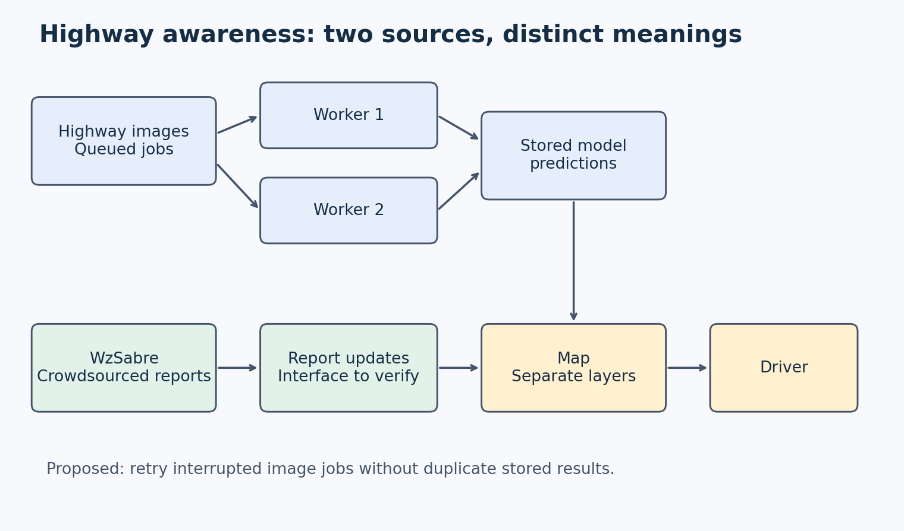

# **Trustworthy Drift Status for Terraform Projects**

**Author:** Benny Wen  
 **Course:** CSC 59866  
 **Selected project and option:** NSF project 06, "SHF: Small: Towards a Unified Approach for DevOps Configuration Drift Detection" (NSF award 2537321\)  
 **Current assignment:** 1  
 **Friday commit deadline:** November 6, 2026, at 11:59 p.m. New York time  
 **Monday presentation:** November 9, 2026, at 6:30 p.m. New York time  
 **Last updated:** November 6, 2026  
 **Document status:** Proposed

## **Progress note**

This is the first version of my design document. I picked the NSF project on DevOps configuration drift, which is when the files that say how a system should be set up stop matching the real servers. I narrowed it down to one question, whether a drift check can be trusted when its look at the real servers is lost, repeated, or old. I plan to build a small command line tool for Terraform that reports in sync, drifted, or unknown. In this version I added the problem, who is affected, my evidence, the existing approaches I looked at, my scope, and a workflow diagram. My biggest open question is whether Terraform's exit codes can tell a failed check apart from one that found drift. Next I will read HashiCorp's official docs and start on the requirements.

## **Contents**

* 1 Problem research and scope  
* 2 Requirements and system specification  
* 3 Alternatives and selected solution  
* 4 Architectural design  
* 5 Component design and interfaces  
* 6 Data structure design  
* 7 Algorithm design and execution  
* 8 Failures and security  
* 9 Implementation and feasibility  
* 10 Testing and verification  
* 11 Operation maintenance and future work  
* 12 Revision history and references

## **1 Problem research and scope**

**Problem and affected people.** Development and Operations (DevOps) is how many software teams build an app, test it, and put it on real servers without doing each step by hand. The settings behind those steps live in configuration files, which are text files that define how things should be set up. Those files must keep matching the code and the real servers. Configuration drift is when they slowly stop matching, because of software changes, environment changes, mistakes, or unknown errors. Think of the files as recipe cards and the servers as the kitchen. Drift is when someone changes the kitchen and never updates the recipe cards. The National Science Foundation (NSF) award associated with this problem is https\://www\.nsf.gov/awardsearch/show-award?AWD\_ID=2537321.

Teams use a drift check to catch this. A drift check is a program that compares the files to the real servers and reports any differences. To do that, it has to look at the real servers, and that look can go wrong for a lot of reasons. The connection can drop, the same look can be sent twice, or the answer can be old. The problem is what a drift check should report when its look goes wrong.

**Concrete scenario.** Many teams describe their servers and networks in files instead of setting them up by hand. This is called infrastructure as code (IaC). One tool for this is Terraform, made by HashiCorp. HashiCorp's tutorial builds a virtual machine, which is a computer rented from a cloud company, and gives it a security group, which is a set of network rules that decides who can log in. A person then swaps that group for a different one by hand, outside the files. Terraform has a check called a refresh only plan. It reads the real machine and shows the old group removed and the new group added ("Manage Resource Drift"). This is the normal behavior of IaC. https\://developer.hashicorp.com/terraform/tutorials/state/resource-drift

Here comes the problem. In one case, the connection to the cloud is lost and no answer comes back. In another, a retry sends the same request twice and the two answers differ. In a third, the answer is outdated and still shows the old security group, so the check says nothing changed while the real machine has different rules. I have not documented that Terraform does this. But a research paper titled “Robust Infrastructure by Verification Agents” (RIVA) says that when tools give incomplete, stale, or misleading output, an automated agent may conclude a system is healthy even though drift has occurred (Abuzakuk et al., sec. 2.3). Its agents run on large language models (LLMs), which are artificial intelligence programs that work with text. https\://arxiv.org/pdf/2603.02345

**Boundaries.** I will focus on one tool, Terraform. The question I am scoping in on is whether its drift check can be trusted when a reading is lost, repeated, or outdated. I will not try to stop drift from occurring or to repair it (tentative).

**Current workflow.**

1. A team describes its servers in Terraform files.  
2. Someone changes a server by hand, so the real server no longer matches the files.  
3. An engineer runs Terraform's refresh-only plan, which reads the real server.  
4. The engineer reads the output and decides whether anything drifted.  
5. The engineer fixes the server or updates the files.

The difficulty occurs at step 3\. If the reading is lost, repeated, or outdated, the output in step 4 may be wrong or missing, and the engineer has no clear way to tell.

The drift check compares what should exist with what exists now. The reading from the real servers is the step my project focuses on, and it can fail in three ways.

**Who or what is affected.** The engineers who run the environment are affected first. For example, an engineer wants remote login to stay limited to approved rules. If an outdated reading hides the swap, the machine keeps the wrong rules and nobody knows. If a lost reading makes the checker report drift that is not real, the engineer may try to fix something that isn't broken. The Terraform tutorial warns that when state and configuration do not match the infrastructure, Terraform will try to reconcile them and may unintentionally destroy or recreate resources ("Manage Resource Drift"). So a false alarm can lead to a real change, and a missed alarm can leave a real problem in place.

Organizations that depend on these systems are affected too. The NSF abstract names healthcare, transportation, and technology as critical sectors that need reliable software, and it says the project aims to reduce the burden on developers. That is the NSF's claim about the project.

| Stakeholder | What they need | Basis |
| :---- | :---- | :---- |
| Engineers who maintain Terraform projects | A drift result they can trust, with a clear "unknown" when the check could not finish | Documented. The NSF abstract says the project aims to reduce the burden on developers who maintain these systems |
| Teams and organizations that depend on these systems | Reliable software and fewer failures and delays | Documented. The NSF abstract names healthcare, transportation, and technology as critical sectors. This is the NSF's claim about its whole project, not evidence about my case |
| Engineers who read a scheduled report | A short status that says how old the last good check is | Assumed. I have not confirmed how teams use such reports |

**Evidence.**

Documented: The NSF abstract says drift leads to system failures, delays, and more maintenance effort ("SHF"). HashiCorp's older guide says drift can come from changes made by hand or by other automation tools (Koehler). The RIVA authors say drift comes from bugs, manual changes, or system updates, and that checking for it is labor intensive and error prone (Abuzakuk et al., abstract and sec. 1). In their tests on a benchmark called AIOpsLab, one tool silently returning wrong data lowered detection success from 50% to 40% and success at finding where the problem was from 22.2% to 11.1% (Abuzakuk et al., sec. 1). Those numbers come from LLM agents on a benchmark, not from Terraform or CloudFormation. https\://www\.hashicorp.com/blog/detecting-and-managing-drift-with-terraform

Observed: I have no observations of this problem in software development, since my experience with DevOps is limited. I have not built or measured anything yet.

Assumed: I assume lost, repeated, and outdated readings happen often enough in real Terraform use to matter. I assume Terraform's exit codes let a wrapper tell a failed check from a changed one, but I still have to confirm that in HashiCorp's official command documentation. None of this has been proven as of now.

Missing evidence: I have not found data on how often drift checkers get failed or outdated readings. The NSF award is still active, but I haven't found any large studies that have produced results yet. However, the AWS docs do mention related issues. https\://docs.aws.amazon.com/AWSCloudFormation/latest/UserGuide/using-cfn-stack-drift.html

**Six-week contribution.** For the first six weeks I will build the smallest working version of my tool. It checks one Terraform project by running the refresh-only plan and reports one of three answers, in sync, drifted, or unknown. If Terraform fails or cannot reach the cloud, the tool says unknown and never in sync. It never changes any infrastructure.

**Semester II scope.** I will build a small command line tool for the people who maintain Terraform projects, the same engineers the sources describe as carrying the burden of drift. Because reading is safe to repeat, the full version retries a failed check a limited number of times and asks for two matching results before it says in sync. It saves the time and result of every check, so the report shows when the last good check happened and warns when that result is too old to trust. I will also include a scheduled job file for GitHub Actions, an automation service, so a team can run the check automatically.

The comparison I will make is between running the refresh only plan by hand and running my tool, on the same small real Terraform project and the same four situations, which are a change made outside Terraform, a failed run, a repeated run, and an old result. I will judge each by correctness. I expect to use Python, the free Terraform program, and a free local setup. For tests, a fake Terraform stand in will return the exit codes I choose.

My solution direction is tentative. The three answers, the retry rule, and the age warning are my first design, and feedback from real users may change them. The work is manageable for one student because it wraps one existing command, needs little code, and needs no paid cloud account. Each feature answers one problem in my paper. Unknown and retries cover a lost reading, two matching results cover a repeated reading, and the age warning covers an outdated reading.

**Exclusions.** I will exclude every tool other than Terraform, source code and application drift, LLM agents, automatic repair, and a web dashboard.

**What I still don't know.** Terraform reports its result to other programs as an exit code, a small number that says whether a run succeeded, failed, or found changes. Can a wrapper, a tool that runs Terraform and reads its results, use those codes to tell a failed check from a check that found drift, and will real Terraform users understand the three answers my tool gives?

To answer this, I will read HashiCorp's official page for the plan command and confirm what each exit code means, because I have only seen those codes on third party pages so far. Second, as I build, I will try the tool on small real Terraform projects to see what it reports when Terraform fails, repeats a check, or gives an old result. If exit codes cannot separate a failure from a change, I would read Terraform's output meant for programs instead. If users misunderstand the unknown answer, I would change its wording and the report layout.

## **2 Requirements and system specification**

## **3 Alternatives and selected solution**

The first existing approach is the Terraform refresh only plan. Terraform keeps a state file, which is its record of the resources it manages. On a plan, it updates that record from the real infrastructure, and the refresh only option shows what would change in the record without touching the infrastructure ("Manage Resource Drift"). The tutorial calls this safer than the older refresh command, which overwrites the state file without showing the updates. The strength of this approach is a read only view of exactly which settings differ. Its limits are that Terraform only refreshes resources under its management (Koehler). The tutorial also notes that without a saved plan file, Terraform cannot guarantee that a later apply will take exactly the shown actions ("Manage Resource Drift"). The pages I read do not say what happens when a reading is lost or outdated. https\://developer.hashicorp.com/terraform/tutorials/state/resource-drift

The second approach is AWS CloudFormation drift detection. AWS stands for Amazon Web Services, Amazon's cloud service, and CloudFormation is its own way to describe servers in files, called templates. It compares what a template says should exist with what exists now, for each resource that supports drift detection ("Detect Unmanaged"). Its strength for this problem is that it has more than two answers. If detection fails for at least one resource, the operation is marked DETECTION\_FAILED and results still appear for the others, and unsupported resources are marked NOT\_CHECKED ("Detect Unmanaged"). Its limits are that it only checks properties the template sets explicitly and it does not check stacks nested inside other stacks. A stack with no supported resources is also reported as IN\_SYNC ("Detect Unmanaged"), so a calm label does not always mean a real check happened. The page does not describe how it handles outdated readings. https\://docs.aws.amazon.com/AWSCloudFormation/latest/UserGuide/using-cfn-stack-drift.html

A research approach is RIVA. Its main idea is that two tool calls with the same goal are unlikely to both be wrong, so it checks each property through different tools and compares them (Abuzakuk et al., sec. 1). When some of its tools returned wrong data, it raised average task success from 27.3% to 50%. The limits are that it depends on LLMs, each task was run only 5 times, and the authors say the benchmark gave too few diagnostic paths (Abuzakuk et al., secs. 4.4, 7). So cross checking is promising, but it has not been tested in a simple non LLM checker. https\://arxiv.org/pdf/2603.02345

None of the pages I read describe a ready tool that gives a small team one plain status, in sync, drifted, or unknown, with the age of the last good check. I have not found any open source tools that do this.

## **4 Architectural design**

## **5 Component design and interfaces**

## **6 Data structure design**

## **7 Algorithm design and execution**

## **8 Failures and security**

## **9 Implementation and feasibility**

## **10 Testing and verification**

## **11 Operation maintenance and future work**

## **12 Revision history and references**

| Revision date | Change to my design | Reason and evidence |
| :---- | :---- | :---- |
| November 6, 2026 | First version. Added the problem, workflow image, stakeholders, and scope | Assignment 1 |

| Open question | Why it matters | Next action |
| :---- | :---- | :---- |
| Can Terraform's exit codes separate a failed check from a check that found drift? | The tool's "unknown" answer depends on it | Read HashiCorp's official plan command documentation |

**Assistance and reuse.** I used ChatGPT to help me better understand what the NSF was asking for to be built as the topic is new to me and I have limited experience with DevOps.

### **References**

* HashiCorp Developer. "Manage resource drift." Terraform tutorial, accessed November 6, 2026\. Supports the example, the refresh only plan, and the warning about reconciling. https\://developer.hashicorp.com/terraform/tutorials/state/resource-drift  
* Koehler, Christie. "Detecting and Managing Drift with Terraform." HashiCorp blog, June 7, 2018, accessed November 6, 2026\. Supports how drift arises. https\://www\.hashicorp.com/blog/detecting-and-managing-drift-with-terraform  
* Abuzakuk, Sami, et al. "RIVA: Leveraging LLM Agents for Reliable Configuration Drift Detection." arXiv preprint 2603.02345, March 2, 2026\. Supports the effect of wrong tool output on drift checks. https\://arxiv.org/pdf/2603.02345  
* Amazon Web Services. "Detect unmanaged configuration changes to stacks and resources with drift detection." AWS CloudFormation User Guide, accessed November 6, 2026\. A second existing approach to compare in Assignment 2\. https\://docs.aws.amazon.com/AWSCloudFormation/latest/UserGuide/using-cfn-stack-drift.html  
* National Science Foundation. "SHF: Small: Towards a Unified Approach for DevOps Configuration Drift Detection." Award 2537321\. Abstract read in the course handout, not on nsf.gov. Supports the definition of drift and the project's goals. https\://www\.nsf.gov/awardsearch/show-award?AWD\_ID=2537321

### **Supporting media and evidence**

* Workflow diagram (workflow.png). Shows where the reading can go wrong.
