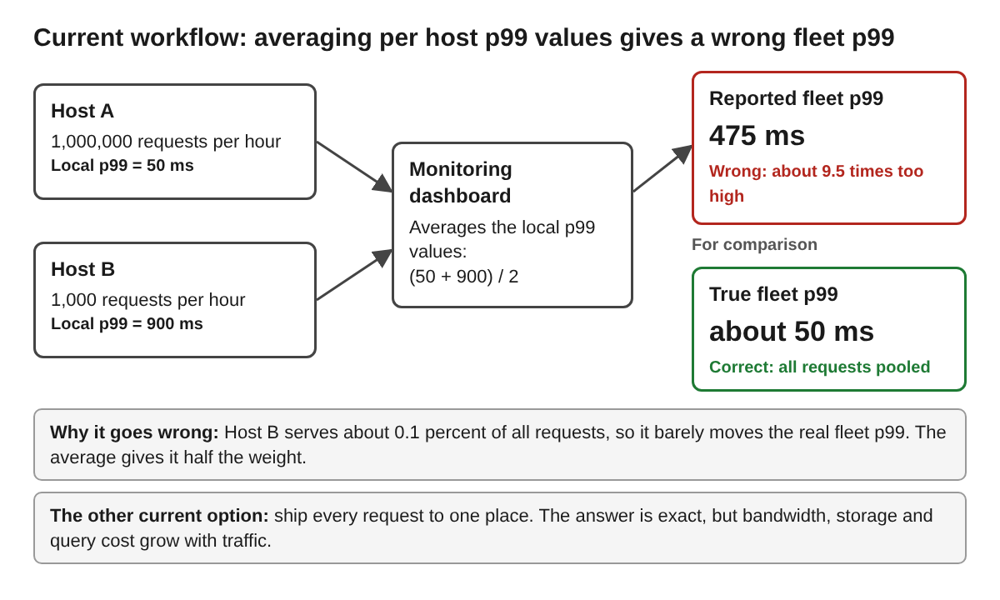

# Fair Scheduling for Shared AI Computing

**Author:** Tanvir Islam  
**Course:** CSC 59866  
**Selected project and option:** A02 Fair scheduling for shared AI computing; Option 1  
**Current assignment:** 2  
**Friday commit deadline:** November 13, 2026, at 11:59 p.m. New York time  
**Monday presentation:** November 16, 2026, at 6:30 p.m. New York time  
**Last updated:** November 15, 2026  
**Document status:** Revised

## Progress note

Feedback on Assignment 1 asked me to explain how I will decide what "fair" GPU use is and how the load will be distributed. I added a definition of fair use to Section 1: every active user is entitled to an equal share of the GPUs, usage is counted in GPU-hours with older usage counting less, and the user furthest below their share goes next. I also listed fairness measures and a success target. I wrote the Section 2 requirements and drafted the Section 3 comparison of FIFO, fair-share, and fair-share with a per-user GPU cap. Working the example by hand showed that fair-share cuts Ana's wait from about 60 hours to about 6 without changing total completion time. The main open issue is how a per-user cap should work without leaving GPUs idle. Next I will choose an approach and design the simulator's parts.

## 1 Problem research and scope

**Problem and affected people:** Students and researchers share a cluster of GPUs, which are the processors used to train artificial intelligence (AI) models. A scheduler decides which waiting job should run next. If one user submits a large batch of jobs, smaller jobs from other users can end up waiting much longer than they actually take to run. The scheduler has to balance giving users fair access while also keeping the GPUs busy.

| Stakeholder | Need | Problem today |
|---|---|---|
| User with small jobs | Quick results | Has to wait behind another user's large batch |
| User with large batches | Finish many long jobs | Fairness rules may limit how many GPUs they can use |
| Cluster administrator | A fair policy that still keeps GPUs busy | Has to choose a policy without fully knowing the trade-offs |

**Current workflow:** First, a user submits a job and says how many GPUs it needs. The scheduler then puts the job into a queue. When enough GPUs become available, the next job starts running. After it finishes, the results are returned to the user. The main problem happens when deciding which job should run next. Slurm, a widely used scheduler, uses first-in, first-out (FIFO) ordering by default ([SchedMD, 2019](https://slurm.schedmd.com/SLUG19/Priority_and_Fair_Trees.pdf)), which means jobs are mainly started based on when they were submitted.

**Scenario:** Imagine an 8-GPU cluster shared by Ana, Ben, and Chen. At 9:00 a.m., Ben submits 20 jobs, with each job needing 4 GPUs for 6 hours. These jobs fill the cluster for about 60 hours. At 9:05 a.m., Ana submits a 30-minute job that only needs 1 GPU. Under FIFO, her job waits about two and a half days. No GPU is sitting idle, so the cluster looks efficient, but the result is still unfair.

**Figure 1.** The current workflow in this example. Since Ben's batch arrived first and uses all the GPUs, Ana's 30-minute job waits about 2.5 days. This waiting problem is what my project focuses on.

**Evidence:**

- *Documented:* The National Science Foundation (NSF) AI Infrastructure Hubs program is expanding access to shared AI computing ([NSF 26-513](https://www.nsf.gov/funding/opportunities/us-national-science-foundation-state-regional-artificial)). This shows a growing need, but not that any policy is unfair.
- *Documented:* A study of Microsoft's shared GPU cluster found jobs delayed while waiting for their fair share and for enough GPUs to free up ([Jeon et al., 2019](https://www.usenix.org/conference/atc19/presentation/jeon)).
- *Observed:* None yet. The scenario is an illustration.
- *Assumed:* Fair-share may shorten the longest waits but increase total completion time.

### How I define fair GPU use

Fair use in this project means **each user who currently has work gets an equal share of the GPUs over time, and no one's small job waits far longer than its size justifies.** The scheduler will distribute GPUs using these rules:

| Rule | What it means | Why |
|---|---|---|
| 1. Equal entitlement | Every user is entitled to the same share. With three active users, each is entitled to 8 / 3 ≈ 2.7 GPUs on average. | Users are in the same department and no one has a reason for higher priority. Slurm's fair-share also starts from assigned shares ([SchedMD, classic fair-share](https://slurm.schedmd.com/classic_fair_share.html)). |
| 2. Only active users count | A user with no waiting or running jobs gives up their share, and it is split among the others. | GPUs should not sit idle just because one user is away. This protects the administrator's goal of keeping GPUs busy. |
| 3. Usage counted in GPU-hours | Usage = GPUs used × hours. A 4-GPU job for 6 hours counts as 24 GPU-hours; Ana's job counts as 0.5. | Counting jobs instead would treat a tiny job and a huge job as equal. |
| 4. Older usage counts less | Past usage is cut in half every 24 simulated hours (a "half-life"). | A user who ran a lot last week should not be punished forever. Slurm uses the same idea through its decay half-life setting. |
| 5. Furthest below share goes next | Each user gets a priority F = 2^(−usage / share), Slurm's fair-share formula. The waiting job from the user with the highest F starts first; ties go to the earlier submission. | Users who have used less than their share move ahead, and the formula is already documented and widely used. |
| 6. Fill gaps | If the next job does not fit in the free GPUs, a smaller job that fits may start instead. | Keeps GPUs busy. Risk: large jobs could keep getting skipped, so I will measure their waits too. |
| 7. No pausing | A running job always finishes. | Pausing a long training job can lose its work, and pausing is outside my scope. |

**How I will measure whether the result is fair:**

- **Longest wait per user (hours):** the main measure. It directly shows Ana's problem.
- **Slowdown per job = (wait + run time) / run time:** judges each wait against job size. Under FIFO, Ana's 30-minute job has a slowdown of about 121; a 6-hour job that waits 6 hours has a slowdown of 2.
- **Jain's fairness index** over the GPU-hours each active user received compared with their entitlement: J = (x₁ + … + xₙ)² / (n × (x₁² + … + xₙ²)). It equals 1 when every user gets exactly their share and 1/n when one user gets everything ([Jain, Chiu, and Hawe, 1984](https://arxiv.org/abs/cs/9809099)).

To make sure fairness is not bought by wasting the cluster, I will also measure **total completion time** (time until all jobs finish), **GPU utilization** (percent of GPU-hours in use), and **average wait**.

**Six-week contribution:** A Python simulation, built with the SimPy event library, of one 8-GPU cluster shared by three users. It will:

1. Read a job list where each job has a user, submit time, GPUs needed (1, 2, or 4), and run time.
2. Run the exact same job list under FIFO and under the fair-share rules above.
3. Use three workloads: **burst** (the Ana and Ben scenario), **balanced** (all users submit similar random jobs), and **one heavy user** (one user submits most of the work at random times). Random workloads run with 10 different seeds so results do not depend on one lucky case.
4. Report each user's longest wait, slowdown, Jain's index, total completion time, and GPU utilization, as tables and charts.

Fair-share counts as **successful** in this project if, in the burst workload, it cuts the worst user's longest wait by at least 50% while increasing total completion time by no more than 10%. This target is proposed and has not been measured.

**Semester II scope:** I will add a third policy, fair-share with a limit on how many GPUs one user can hold at once, and test larger and more realistic job sets.

**Exclusions:** This project does not include real hardware, making individual jobs run faster, scheduling across multiple clusters, billing, security, or pausing jobs that are already running.

## 2 Requirements and system specification

| ID | Required behavior and conditions | Acceptance check | Design and test reference |
|---|---|---|---|
| F1 | Load a job list from a CSV file with user, submit time, GPUs, and run time; reject invalid jobs with a clear message | Loading the burst scenario gives 21 jobs; a job asking for 10 GPUs is rejected | Add as design develops |
| F2 | Run the same job list under FIFO and fair-share | Both runs finish all 21 burst jobs | Add as design develops |
| F3 | Record each job's start, finish, and wait, and each user's longest wait and slowdown | Under FIFO, Ana's wait is reported as 59 h 55 min | Add as design develops |
| F4 | Report total completion time, GPU utilization, and Jain's fairness index for each run | Results table has one row per policy with all three values | Add as design develops |
| F5 | Give identical results for the same input and seed | Two runs with seed 1 produce identical output files | Add as design develops |
| C1 | GPUs in use never exceed 8, and a job never starts with fewer GPUs than it asked for | Two jobs that fit separately but not together become ready at the same moment; only one may start | Add as design develops |
| C2 | Every job runs exactly once and never starts before it was submitted | Count of finished jobs equals count of jobs loaded; no start time is earlier than its submit time | Add as design develops |
| Q1 | Burst workload: fair-share cuts the worst user's longest wait by at least 50% versus FIFO, with total completion time no more than 10% higher | Compare the two runs' results tables | Proposed target, not yet measured |

**Inputs and outputs:**

*Ordinary example.* Input: Ben's 20 jobs (4 GPUs, 6 hours) at 9:00 and Ana's job (1 GPU, 30 minutes) at 9:05. Expected output, worked out by hand and still to be confirmed by the simulator:

| Policy | Ana's wait | Ben's last job finishes | Total completion time | GPU utilization |
|---|---|---|---|---|
| FIFO | 59 h 55 min | +60 h | 60 h 30 min | about 99% |
| Fair-share | 5 h 55 min | +60 h 30 min | 60 h 30 min | about 99% |

Under fair-share, Ana's job starts at 3:00 p.m., when Ben's first two jobs finish, because her usage is zero and Ben's is high. Ben's remaining jobs shift by 30 minutes, but the cluster finishes at the same time.

*Unsuccessful example.* Input: a job asking for 10 GPUs, or with a negative run time. Output: the job is rejected before the simulation starts, with a message such as "Job 22 asks for 10 GPUs; the cluster has 8," and no results are produced for it.

**Assumptions:**

- Run times are known when the job is submitted. In real clusters they are only estimates; I will check this later by adding random error to run times.
- All 8 GPUs are identical and on one machine, so where a job is placed does not matter.
- Users do not change their behavior to game the scheduler.
- Jobs never fail.

**Constraints:** Six weeks, Python with SimPy on a laptop, no real cluster, and generated job data unless a usable public trace is found.

## 3 Alternatives and selected solution

| Approach and source | Useful behavior | Limitation | Evidence or assumption |
|---|---|---|---|
| FIFO, simple baseline ([SchedMD, 2019](https://slurm.schedmd.com/SLUG19/Priority_and_Fair_Trees.pdf)) | Simple, predictable, keeps GPUs busy; meets F1–F5, C1, and C2 easily | Fails Q1 in the burst workload: Ana waits about 60 hours | Documented as Slurm's default; wait time from hand calculation |
| Fair-share priority ([SchedMD, classic fair-share](https://slurm.schedmd.com/classic_fair_share.html)) | Moves users below their share ahead; expected to cut Ana's wait to about 6 hours with no change in completion time | Cannot help until a running job finishes, because there is no pausing; may delay large jobs; needs usage tracking | Formula documented by Slurm; result is a hand-calculated expectation |
| Fair-share plus per-user GPU cap (my Semester II idea) | Keeps some GPUs free so small jobs can start immediately | If the cap applies all the time, GPUs sit idle when only one user is active: with a cap of 6 and 4-GPU jobs, Ben can use only 4 of 8 GPUs | Assumed; to be tested in Semester II |
| Finish-time fairness, Themis ([Mahajan et al., 2020](https://www.usenix.org/conference/nsdi20/presentation/mahajan)) | Designed for AI jobs; improved fairness by more than 2.25 times on a production trace | Auction design is complex and built for large clusters; too much for six weeks | Documented in the paper; used as a reference only |

**Choice and reason:** Draft only. Fair-share priority is the leading candidate because it targets Q1 directly, uses a documented formula, and can be compared fairly against the FIFO baseline on the same jobs. The final choice and decision records come in Assignment 3.

## 4 Architectural design

*Work to come in Assignment 3.*

## 5 Component design and interfaces

*Work to come in Assignment 3.*

## 6 Data structure design

*Work to come in Assignment 4.*

## 7 Algorithm design and execution

*Work to come in Assignment 4.*

## 8 Failures and security

*Work to come in Assignment 4.*

## 9 Implementation and feasibility

*Work to come in Assignments 3–6.*

## 10 Testing and verification

*Work to come in Assignments 4–6.*

## 11 Operation maintenance and future work

*Work to come in Assignments 4–6.*

## 12 Revision history and references

| Revision date | Change to my design | Reason and evidence |
|---|---|---|
| November 6, 2026 | First version: Section 1 | Assignment 1 |
| November 15, 2026 | Added fair-use rules, fairness measures, success target, and workloads to Section 1; wrote Section 2; drafted Section 3 | Feedback asked how "fair" is decided and how load is distributed |

| Open question | Why it matters | Next action |
|---|---|---|
| How should a per-user GPU cap work without leaving GPUs idle when only one user is active? | A fixed cap either helps small jobs or keeps GPUs busy, but not both | Test caps that apply only while another user has waiting jobs, and compare GPU utilization |
| Can I find realistic job data? | Generated jobs may not match real workloads | Check whether the Jeon et al. (2019) job trace is public |

### References

- SchedMD. [Slurm priority, fairshare and fair tree](https://slurm.schedmd.com/SLUG19/Priority_and_Fair_Trees.pdf). 2019. Slurm's default FIFO ordering.
- SchedMD. [Classic fairshare algorithm](https://slurm.schedmd.com/classic_fair_share.html). Slurm documentation. Fair-share formula F = 2^(−U/S) and usage decay.
- Jeon, M., et al. [Analysis of large-scale multi-tenant GPU clusters for DNN training workloads](https://www.usenix.org/conference/atc19/presentation/jeon). USENIX ATC, 2019. Measured delays in a shared GPU cluster.
- Mahajan, K., et al. [Themis: Fair and efficient GPU cluster scheduling](https://www.usenix.org/conference/nsdi20/presentation/mahajan). USENIX NSDI, 2020. Finish-time fairness for AI jobs.
- Jain, R., Chiu, D., and Hawe, W. [A quantitative measure of fairness and discrimination for resource allocation in shared computer systems](https://arxiv.org/abs/cs/9809099). DEC Technical Report, 1984. Jain's fairness index.
- National Science Foundation. [State and Regional AI Infrastructure Hubs (NSF 26-513)](https://www.nsf.gov/funding/opportunities/us-national-science-foundation-state-regional-artificial). 2026. Published opportunity.
